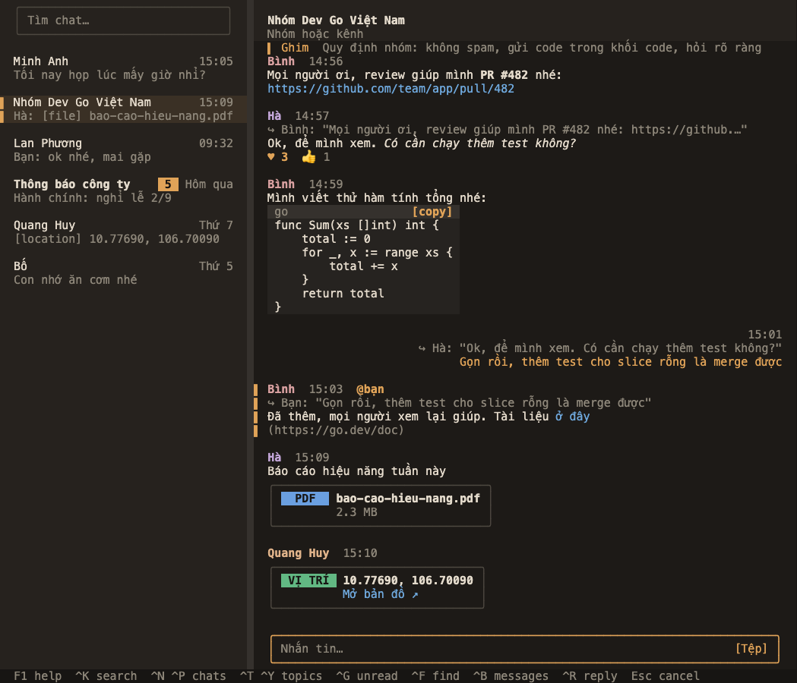

# bonagram

**English** | [Tiếng Việt](README.vi.md)

Telegram in a terminal tab: new messages with a bell, desktop notifications and an unread count in the tab title, and you reply right where you are without switching to another app.

Written in Go with [gotd/td](https://github.com/gotd/td) (the Telegram connection) and [Bubble Tea](https://github.com/charmbracelet/bubbletea) (the terminal UI). This is an **unofficial** client: you sign in with your own Telegram account. It is a single executable, nothing else to install.

> **Heads-up:** the interface text (hints, notices, the in-app guide) is in **Vietnamese** only for now. Chat content is shown as is, in any language.



*Illustration: sample data (made-up names and messages), rendered from the app's own output. Real colours and fonts depend on your terminal.*

## Features

- A search box and the open chat's name share one band at the top; the second line says what kind of chat it is (`@username`, group, number of topics, muted). The search box and the message box use the same border style, and the border changes colour while the cursor is in it.
- Chat list on the left (clickable): two lines per chat, name with unread count and time, then the last message with the sender's name in groups.
- Search chats with `Ctrl+K` or by clicking the search box: accent-insensitive ("dat" finds "Đạt"), also matches usernames.
- Switch between chats with the keyboard, jump to the next chat with unread messages.
- New messages show up at once: bell, a small notice at the top, a desktop notification when the tab is not focused, `(3) bonagram` in the tab title. Muted chats do not ring. Messages missed while offline are fetched again when the connection returns.
- Reply to any message. Messages you send show up immediately.
- Scroll to the top to load older messages (capped, see Configuration).
- Forum groups (topics): each topic is a tab with its own unread count.
- Images: full-screen viewer, optional thumbnails inside the chat. Videos, files and GIFs open in the system's app.
- Code blocks with a language header and a **copy** button; inline code has its own background.
- Other people's reactions appear under the message, yours is highlighted. You can react too.
- Edit and delete your own messages, forward, open links, send photos or files (`/file`), pinned message shown at the top of the chat, unsent text kept per chat. See "Working with messages".
- System messages are described in words: someone joined or left, was added or removed, group renamed, message pinned, topic created, calls (missed or duration), auto-delete timer. Rare event types show as `[sự kiện: Name]`.
- Bots that stream an answer by editing one message again and again are shown live.
- Archived chats are hidden, like in Telegram. Pinned chats stay on top.
- Drag the vertical divider between the chat list and the messages to change the width (remembered next time).
- Typing Vietnamese (Telex/VNI) shows up in the input box as you type.

## Requirements and pre-flight checklist

Tick each item; if one fails, follow the right-hand column.

| ☐ | You need | Check with | If it fails |
|---|---|---|---|
| ☐ | **Go 1.26 or newer** (only to build) | `go version` | Install from <https://go.dev/dl>. Go 1.21+ downloads the right version automatically when building, but needs network |
| ☐ | **A network that reaches Telegram** (and the Go modules on the first build) | The official Telegram app works on the same network | Use a VPN. The app does **not support proxies** (SOCKS, MTProxy) |
| ☐ | **A Telegram account** with an `api_id` and `api_hash` | See "Getting `api_id` and `api_hash`" | Create them at <https://my.telegram.org> |
| ☐ | **A terminal with 24-bit colour** | `echo $COLORTERM` prints `truecolor` or `24bit` | Use Ghostty, Kitty, WezTerm, iTerm2, Alacritty... macOS Terminal.app does not support it: colours will be wrong |
| ☐ | **A terminal with mouse support** | You can click a chat after opening the app | Enable mouse reporting in your terminal |
| ☐ | **UTF-8 locale** (for Vietnamese text and emoji) | `locale` or `echo $LANG` contains `UTF-8` | `export LANG=en_US.UTF-8` (or `vi_VN.UTF-8`) |
| ☐ | **A window of at least 80x24** | `tput cols; tput lines` | Enlarge the window. Smaller still works without errors, but is cramped |
| ☐ | (Linux) clipboard and file-opening tools | `command -v xclip wl-copy xdg-open` | Install `xclip` (X11) or `wl-clipboard` (Wayland), and `xdg-open`. Without them the copy button only uses OSC 52, and files cannot be opened in outside apps |
| ☐ | (tmux) the right options | See "Using it in tmux" | Add them to `~/.tmux.conf` |

**Platforms:** macOS has been used for real (Apple Silicon). Linux (amd64, arm64) builds but has not been run. Windows builds but has not been run, and cannot open files in outside apps.

**Recommended terminal:** Ghostty or Kitty (real images, desktop notifications, clipboard). Other terminals work, with a few features limited (see "Limitations").

## Install

From the source directory:

```bash
go build -ldflags="-s -w" -o bonagram .
./bonagram
```

To stamp a version number into the executable (so users can report the right build): `go build -ldflags="-s -w -X main.version=0.1.0" -o bonagram .`

Command line:

| Command | What it does |
|---|---|
| `bonagram` | Start the app |
| `bonagram --version` (or `-v`) | Print the version, Go version and platform |
| `bonagram --help` (or `-h`) | Print short usage |

An unknown option prints an error and exits with code 2 without starting the app.

To run it from any directory, copy `bonagram` into a directory on your `PATH`, for example `~/.local/bin`.

## Getting `api_id` and `api_hash`

1. Go to <https://my.telegram.org> and sign in with your Telegram phone number.
2. Choose **API development tools** and create an application (name and description are up to you).
3. Copy the **App api_id** (a number) and **App api_hash** (a long string).

`api_id` and `api_hash` are yours alone: do not share them and do not commit them to git.

## Signing in and running

```bash
./bonagram
```

The first time: enter `api_id` and `api_hash`, then your phone number (a number starting with `0` is taken as a **Vietnamese** number and turned into `+84...`; for other countries type it in full as `+<country code>...`), the code Telegram sends you, and the two-step password if you have one. The app then opens. Later runs start straight away without asking again.

Open it in its own terminal tab and leave it there. Quit with `Ctrl+Q`.

Settings and the login session live in `~/.config/bonagram/`:

| File | Contents |
|---|---|
| `env` | `api_id`, `api_hash` and options |
| `session.json` | The login session |
| `width` | Width of the chat list |
| `help-seen` | An empty file marking that the app already opened the guide on first launch (delete it to see the guide again) |

## Keys

| Key | What it does |
|---|---|
| `Ctrl+K` | Search chats (`↑` `↓` pick a result, `Enter` open, `Esc` cancel) |
| `Ctrl+N` / `Ctrl+P` | Next / previous chat |
| `Ctrl+G` | Jump to a chat with unread messages |
| `Ctrl+T` / `Ctrl+Y` | Next / previous topic (forum groups) |
| `Ctrl+B` | Select a message in the message pane (`↑` `↓` move, `Esc` leave) |
| `Enter` on a message with a photo or file | Open the photo full screen (`Esc` or `Q` close, `O` open in the system app) |
| `Enter` or `Ctrl+R` on a normal message | Reply to it (`Ctrl+R` with nothing selected: reply to the newest message) |
| `C` (while selecting a message) | Copy the message's code block; press again for the next block. A message without code is copied whole |
| `E` `D` `R` `F` `O` `M` (while selecting a message) | Edit, delete, react, forward, open link, jump to @mention. See the next section |
| `Ctrl+U` / `Ctrl+W` | Delete the text before the cursor (at the end of the line that clears the box) / delete one word. Cursor in the middle of the line: press `End` first |
| `Esc` | Cancel a reply or an edit |
| `↑` on the first message, `PgUp`, mouse wheel up | Load older messages |
| `F1` | Open / close the key guide inside the app (`↑` `↓` scroll, `Esc` close). The very first launch opens it once automatically |
| `Ctrl+Q` | Quit |

Mouse:

- Click a chat to open it, the search box to search, a topic tab to switch topic.
- Click a message to select it: a photo or file opens at once, any other message is highlighted so `E`/`D`/`R`/`F`/`O` work on it (`Enter` replies to it).
- Click `[copy]` on a code block to copy the code.
- Scroll over the chat list or the messages; drag the vertical divider to resize.
- Because the app turns on mouse reporting, hold `Shift` while dragging to select text with the mouse.

## Working with messages

Press `Ctrl+B` (or click a message) to select it, then:

| Key | What it does |
|---|---|
| `E` | **Edit** your message: its text goes into the input box, press `Enter` to save or `Esc` to cancel |
| `D` | **Delete** your message for everyone. The app asks first: only `Y` deletes, any other key keeps it |
| `R` | **React**: press `1`..`7` (👍 👎 ❤ 🔥 🎉 😁 😢). Press the same one again to take it back |
| `F` | **Forward**: pick the target chat in the list on the left (type to search), `Enter` to send, `Esc` to cancel. In a forum group the message goes to the General topic |
| `O` | **Open a link** from the message in your browser (http/https only). With several links, press `O` again for the next one |
| `M` | Jump up to the nearest @mention among the loaded messages |

Other things:

- **Sending a photo or file**: type `/file ` and a path, or drag a file from Finder into the terminal so the terminal pastes the path. Example: `/file ~/Downloads/report.pdf`. A jpg/png under 10 MB is sent as a photo, anything else as a file. While replying to a message, the file is sent as a reply to it.
- **Pinned message**: the `▍ Ghim` line at the top of a chat is the newest pinned message (in a forum group, the one for the open topic). It costs one request when the chat is opened.
- **Drafts**: text you were typing is kept per chat and per topic when you go elsewhere, and is still there when you come back. Drafts live in memory only: quitting the app loses them.

These actions only run when you press the key; each is one request to Telegram, and nothing runs in the background.

## Images and files

Kitty and Ghostty show real images; other terminals (and tmux) use coloured half-blocks. If images do not display correctly in your terminal, set `BONAGRAM_IMAGES=blocks` (always use blocks) or `BONAGRAM_IMAGES=kitty` (force the Kitty protocol).

Files other than images are only opened in the system app if they are a familiar type (images, video, audio, PDF, text, Office documents). Anything else is only saved to the cache folder and its path is shown, because opening an arbitrary file received in a chat could run code.

## Code blocks and copy

The `[copy]` button copies the code block verbatim to the clipboard with an OSC 52 sequence (supported by Ghostty, Kitty, WezTerm and iTerm2, and it works over SSH) and also calls `pbcopy` (macOS), `wl-copy` or `xclip` when present. macOS Terminal.app does not support OSC 52, so it relies on `pbcopy`. Inside tmux you need `set -g set-clipboard on`.

## Configuration

Put these in `~/.config/bonagram/env` (one `KEY=value` per line) or in environment variables. The `env` file wins over an environment variable of the same name. A bad value falls back to the default; an out-of-range value is clamped to the nearest bound.

```
TG_API_ID=1234567
TG_API_HASH=<your 32-character api_hash>

# Options (these are the defaults)
BONAGRAM_MAX_MESSAGES=500
BONAGRAM_PREVIEWS=0
BONAGRAM_PREVIEW_ROWS=8
BONAGRAM_PREVIEW_COUNT=8
BONAGRAM_FPS=60
```

| Key | Default | Meaning |
|---|---|---|
| `TG_API_ID`, `TG_API_HASH` | required | The API credentials from above |
| `BONAGRAM_MAX_MESSAGES` | `500` (40 to 5000) | Most messages loaded while scrolling back through history. Higher uses more memory |
| `BONAGRAM_PREVIEWS` | `0` (0 or 1) | `1` shows photo thumbnails inside the chat |
| `BONAGRAM_PREVIEW_ROWS` | `8` (0 to 30) | Only with `BONAGRAM_PREVIEWS=1`: maximum thumbnail height in rows |
| `BONAGRAM_PREVIEW_COUNT` | `8` (0 to 50) | Only with `BONAGRAM_PREVIEWS=1`: only the newest N photos in a chat get thumbnails |
| `BONAGRAM_IMAGES` | auto | `kitty` or `blocks`: force how images are drawn |
| `BONAGRAM_FPS` | `60` (10 to 120) | Maximum frames per second. Lower uses less CPU when idle but typing and scrolling feel less smooth |

## Memory, CPU and disk

Measured on macOS (Apple Silicon) with a real account of 117 chats, run inside tmux so images were drawn as blocks.

**Memory**

| Situation | RSS | Physical memory (`footprint`) |
|---|---|---|
| Just started, chat list loaded | 26.5 MB | 15 MB |
| One chat open (40 messages) | 26.8 MB | 15 MB |
| Scrolled back to the 500-message cap | 28.7 MB | 16 MB |
| After some use, then idle | about 25 MB | n/a |

RSS includes shared system libraries; the physical-memory column is what the OS attributes to the app alone and is steadier. Memory barely grows when more messages load because the app only keeps message data and builds no UI component per message.

**CPU** (percent of one core)

| Situation | CPU |
|---|---|
| Startup (connect and load 117 chats) | about 0.1 s of CPU |
| Idle | about 0.7% (0.4% with `BONAGRAM_FPS=30`) |
| Continuous mouse scrolling (1,000 events in 10 s, very fast scrolling) | about 8% |
| 15 messages arriving in a burst | about 1.0% |

The app redraws at most 60 frames per second. Lower it with `BONAGRAM_FPS` to save CPU: 30 fps gives about 0.4% idle, 20 fps about 0.3%, at the cost of typing and scrolling feeling a little slower (worst-case draw delay 33 ms at 30 fps, 50 ms at 20).

**Disk**

| Item | Size |
|---|---|
| The `bonagram` executable (built with `-s -w`) | about 17 MB |
| `~/.config/bonagram/` | a few dozen KB |
| Cache of downloaded photos and files (`~/Library/Caches/bonagram/` on macOS, `~/.cache/bonagram/` on Linux) | depends on how many you view: a few hundred KB to a few MB per photo |

The cache is never cleaned automatically: delete that `bonagram/` folder whenever you like, the app downloads again when needed.

Notes on the numbers: each situation was measured once (figures vary by a few percent between runs); images drawn with the Kitty protocol in Ghostty were not measured, nor were accounts with thousands of chats. For real use, plan on about 25 to 35 MB of RSS.

## Using it in tmux

Add this to `~/.tmux.conf` and reload (`tmux source ~/.tmux.conf`):

```
set -g default-terminal "tmux-256color"
set -ga terminal-overrides ",*:RGB"   # 24-bit colour
set -g set-clipboard on               # copy button
set -g focus-events on                # notifications and read marks at the right moment
set -g mouse on
```

Inside tmux, images are always drawn as blocks (the Kitty protocol is not used).

## Data and security

- `~/.config/bonagram/session.json` **gives full access to your Telegram account**. Anyone with this file can read and send messages as you. Do not share it and do not put it in git.
- `~/.config/bonagram/env` contains `api_hash`, so keep it at mode `600` (the app creates it that way).
- The app only talks to Telegram's servers; it sends data nowhere else.
- Opening a chat in the app marks it as read, like the official Telegram apps.
- Names and message text received from Telegram have control characters stripped before display, so a sender cannot inject commands into your terminal.

## Troubleshooting

| Symptom | What to do |
|---|---|
| `API_ID_INVALID` | `api_id`/`api_hash` are wrong. Fix them in `~/.config/bonagram/env`, or delete that file to enter them again |
| Stuck while connecting | Check your network and VPN. Proxies are not supported |
| Phone number rejected | A number starting with `0` becomes `+84...` (Vietnam). For other countries type it in full as `+<country code>...` |
| Archived chats are missing | By design: Archived chats are hidden |
| Images missing or distorted | Set `BONAGRAM_IMAGES=blocks`. In tmux images are always blocks |
| Wrong or washed-out colours | Your terminal lacks 24-bit colour: switch terminal or check `echo $COLORTERM` |
| Vietnamese or emoji show as boxes or misaligned | Check the UTF-8 locale and that your font has those characters |
| `[copy]` does not copy | Your terminal may not support OSC 52; in tmux enable `set -g set-clipboard on` |
| Half-typed Vietnamese (IME) text appears in the wrong place | Report it with the input method and terminal you use |
| A `bonagram` process is still running after you quit | Stop it with `pkill bonagram` (a leftover process keeps the login session open). If it happens, report how you quit the app |
| Sign out | Delete `~/.config/bonagram/session.json`, or end the session in Telegram under Settings, Devices |
| Start over | Delete the whole `~/.config/bonagram/` folder |

## Limitations

**Account and network**
- One account per run (to switch accounts, delete `~/.config/bonagram/session.json`).
- No proxy support. Where Telegram is blocked you need a VPN.
- The app appears as a new device in Telegram under Settings, Devices.
- Signing in many times in a row can make Telegram pause code sending for a while (FLOOD_WAIT): wait and retry.
- Do not use it to send messages in bulk: Telegram may limit or ban the account.

**Data loaded**
- At most 1,000 main-folder chats; archived chats are hidden.
- Opening a chat loads the latest 40 messages; scrolling up loads more, up to `BONAGRAM_MAX_MESSAGES` (default 500, at most 5,000).
- At most 100 topics per forum group.
- Messages edited by others (including bots streaming an answer by editing one message) update live, redrawn at most 4 times a second. Messages deleted by others only disappear after you restart the app.
- The pinned message is refreshed when a chat is opened; pinning or unpinning while you are viewing it only shows after you reopen the chat.
- An archived chat that receives a new message (and which Telegram un-archives on its own) only shows again after you restart the app.

**In development** (not in this version)
- A button that opens a file-picker dialog, sending several files at once (album), and adding a caption to files you send. For now only single files can be sent with `/file`, with no caption.

**Features not available**
- Sending: plain text, photos and files (`/file`, without caption). No voice messages, text formatting, or several files at once. Telegram limits a message to 4,096 characters; longer ones give a send error.
- Reactions: only 7 fixed emoji; if a chat does not allow that emoji (for example Saved Messages), Telegram refuses and the app shows an error. Edit and delete only work on your own messages (in Saved Messages, on all of them). Deleting cannot be undone.
- Forwarding: one message at a time, keeps the original sender's name, goes to the General topic if the target is a forum group.
- Messages you send with `/file` or forward appear after a few seconds, when the app reloads the newest messages of that chat.
- Display: bold, italic, clickable links with the mouse (use the `O` key), syntax colouring in code blocks, custom emoji images, seeing who reacted. Stickers, voice messages, polls, locations... show as labels such as `[file]`, `[media]`.
- Secret chats, calls and stories: not supported.
- The interface is Vietnamese only, with a single fixed dark palette.
- A chat with a new message jumps to the top of the unpinned chats; pinned chats always stay on top, in place. Pinning or unpinning a chat while the app is running only shows after you restart.

**Terminal-dependent**
- Real images only on Kitty and Ghostty; elsewhere coloured blocks.
- Desktop notifications and correct read marks need the terminal to report window focus. If it does not, the app assumes the window is always being watched.
- The copy button uses OSC 52 (Ghostty, Kitty, WezTerm, iTerm2) and the `pbcopy`, `wl-copy`, `xclip` tools; Terminal.app only works through `pbcopy`.
- Half-typed text from a Vietnamese input method only appears in the right place if the terminal draws it at the cursor position. Not checked on every terminal.
- Because the app turns on mouse reporting, hold `Shift` while dragging to select text.

## Development

```bash
go vet ./... && go test -race ./...    # tests never connect to Telegram
go test -run TestModelFlow ./...       # run one test
```

The test suite uses fake data: it sends messages into the UI model and checks the frames. The code that calls the Telegram API can only be verified by running the app against a real account.

## License

[MIT](LICENSE). The libraries it builds on are under their own permissive licenses (MIT, BSD, ISC, Apache-2.0).

## Notes

This is a personal project that uses Telegram's API through a user account. Use it only with your own account and do not use it to send messages in bulk: Telegram may limit or ban accounts that break its terms of service.
