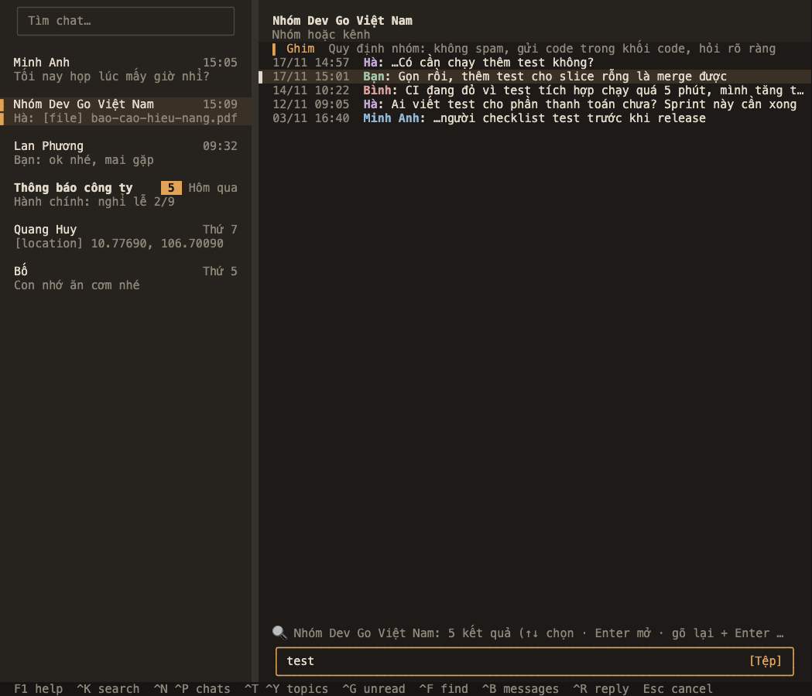

# bonagram

**English** | [Tiếng Việt](README.vi.md)


**Telegram in a terminal tab.** New messages ring a bell, raise a desktop notification and show an unread count in the tab title; you answer right where you are, without switching apps.

Written in Go with [gotd/td](https://github.com/gotd/td) (the Telegram connection) and [Bubble Tea](https://github.com/charmbracelet/bubbletea) (the terminal UI). This is an **unofficial** client: you sign in with your own Telegram account. One executable, nothing else to install.

> **Heads-up:** the interface text (labels, hints, notices, the in-app guide) is in **Vietnamese** only for now. This README gives each label with its meaning. Chat content is shown as is, in any language.


*Sample data (made-up names and messages), rendered from the app's own output by `scripts/shots.sh`: a reply quote, formatting, links, a code block, a file card and a location card. Real colours and fonts depend on your terminal.*

<details>
<summary>Screenshot: searching a chat with <code>Ctrl+F</code></summary>



</details>

## Contents

- [Highlights](#-highlights)
- [Quick start](#-quick-start)
- [Requirements](#-requirements)
- [Install](#-install)
- [First sign-in](#-first-sign-in)
- [Using bonagram](#-using-bonagram): the chat list, reading, writing and sending, working with a message, images, video and files
- [Keys and mouse](#-keys-and-mouse)
- [Configuration](#-configuration)
- [Terminals, tmux and clipboard](#-terminals-tmux-and-clipboard)
- [Data and security](#-data-and-security)
- [Troubleshooting](#-troubleshooting)
- [Limitations](#-limitations)
- [Performance](#-performance)
- [Development](#-development) · [License](#-license)

## ✨ Highlights

- **Messages arrive at once:** a bell, a small notice in the app, a desktop notification when the tab is not focused, `(3) bonagram` in the tab title. Muted chats stay quiet. Messages missed while offline are fetched again.
- **Messaging like the official app:** reply, edit, delete, forward, react, pin, `@mentions`, send photos and files (several at once, with a caption), send a location.
- **Multi-line message box:** `**bold**` `__italic__` `` `code` `` formatting, emoji suggestions after `:`, undo, Vietnamese input methods (Telex/VNI).
- **Right-click menus:** on a message (one-click reactions, reply, pin, delete…) and on a chat (pin, mute, delete).
- **Read receipts:** `✓` when sent, `✓✓` once read. Reading on your phone lowers the unread counts here too.
- **Fast search:** chats without typing accents (`dat` finds `Đạt`), people and groups not in your list yet, and the text of a chat.
- **Real images in the terminal** (Kitty, Ghostty), video through mpv, code blocks with a copy button.
- **Light:** about 25 MB of memory, next to no CPU when idle. In a narrow window the chat list folds into a column of initials.

## 🚀 Quick start

1. **Get the executable** from the [Releases page](https://github.com/khoinguyenvk9/bonagram/releases), or build it: `go build -ldflags="-s -w" -o bonagram .`
2. **Get an `api_id` and `api_hash`** at <https://my.telegram.org> → *API development tools* (see [First sign-in](#-first-sign-in)).
3. **Run** `./bonagram`, enter those two values, your phone number and the code Telegram sends. Done.

Press `F1` in the app at any time for the key guide. The bottom row of the screen always lists the keys that work right now.

## 📋 Requirements

Tick each item; for anything missing, follow the right-hand column.

| ☐ | You need | Check with | If not |
|---|---|---|---|
| ☐ | **Go 1.26 or newer** (only to build from source) | `go version` | Install from <https://go.dev/dl>. Go 1.21+ fetches the right version by itself (needs network) |
| ☐ | **A network that reaches Telegram** | The official Telegram app works on the same network | Use a VPN. **No proxy support** yet (SOCKS, MTProxy) |
| ☐ | **A Telegram account** with an `api_id` and `api_hash` | See [First sign-in](#-first-sign-in) | Create them at <https://my.telegram.org> |
| ☐ | **A terminal with 24-bit colour** | `echo $COLORTERM` prints `truecolor` or `24bit` | Use Ghostty, Kitty, WezTerm, iTerm2, Alacritty… macOS Terminal.app lacks it: colours will be wrong |
| ☐ | **Mouse support in the terminal** | Clicking a chat works after start | Turn on mouse reporting in the terminal |
| ☐ | **A UTF-8 locale** (Vietnamese text, emoji) | `echo $LANG` contains `UTF-8` | `export LANG=en_US.UTF-8` |
| ☐ | **A window of 80×24 or more** | `tput cols; tput lines` | Smaller still works; under 76 columns the chat list folds into initials |
| ☐ | (Linux) clipboard and file-opening tools | `command -v xclip wl-copy xdg-open` | Install `xclip` (X11) or `wl-clipboard` (Wayland), and `xdg-open` |
| ☐ | (Optional) [mpv](https://mpv.io), a Nerd Font | `command -v mpv` | mpv plays video in the terminal; a Nerd Font gives the menu icons (built into Ghostty, Kitty, WezTerm) |

**Platforms:** used daily on macOS (Apple Silicon). Linux (amd64, arm64) and Windows are built and tested on GitHub Actions but nobody has used them with a real account yet. Windows cannot open files in other apps yet.

**Recommended terminals:** **Ghostty** or **Kitty**: real images, desktop notifications, clipboard, icons built in.

## 📦 Install

**Prebuilt executable (no Go needed).** Download the archive for your system from the [Releases page](https://github.com/khoinguyenvk9/bonagram/releases) (`darwin` = macOS, `arm64` = Apple Silicon / ARM, `amd64` = Intel/AMD), unpack it and run `bonagram` (`bonagram.exe` on Windows). You can check the download against `checksums.txt`. The executables are not signed, so the first start may be blocked:

- **macOS:** `xattr -d com.apple.quarantine ./bonagram` (or right-click › Open in Finder).
- **Windows:** SmartScreen says "unknown publisher": choose More info › Run anyway.

**From source:**

```bash
go build -ldflags="-s -w" -o bonagram .
./bonagram
```

To stamp a version into the executable (so bug reports name the right build): `go build -ldflags="-s -w -X main.version=<version>" -o bonagram .`

To run it from anywhere, copy `bonagram` into a folder on your `PATH`, for example `~/.local/bin`.

| Command | What it does |
|---|---|
| `bonagram` | Opens the app |
| `bonagram --version` (`-v`) | Prints the version, Go version and platform |
| `bonagram --help` (`-h`) | Prints a short usage |

An unknown option prints an error and exits with code 2.

## 🔑 First sign-in

**Getting an `api_id` and `api_hash`:**

1. Go to <https://my.telegram.org> and sign in with your Telegram phone number.
2. Open **API development tools** and create an application (any name and description).
3. Copy the **App api_id** (a number) and **App api_hash** (a long string). They are yours alone: do not share them or commit them.

**Run `./bonagram`:** enter the `api_id`, the `api_hash`, then your phone number, the code Telegram sends and your two-step password if you have one. A number starting with `0` is read as a **Vietnamese** number (turned into `+84…`); other countries need the full `+<country code>…`. Later starts go straight in. The first start opens the key guide (`F1`) once.

Keep it open in its own terminal tab. Quit with `Ctrl+Q`.

Settings and the session live in `~/.config/bonagram/`:

| File | Content |
|---|---|
| `env` | `api_id`, `api_hash` and options (see [Configuration](#-configuration)) |
| `session.json` | The session: **full access to your account**, keep it private |
| `width` | Width of the chat list; `8` means folded |
| `help-seen` | Marks that the guide was shown once (delete it to see it again) |

## 💬 Using bonagram

> On macOS keys are written the Mac way: `⌃` is Control, `⌥` is Option, `⏎` is Return. `⌃K` = `Ctrl+K`.

### The chat list

- **Open a chat:** click it, or `Ctrl+N` / `Ctrl+P` for the next / previous one, `Ctrl+G` for the next chat with unread messages.
- **Search chats:** `Ctrl+K` or click the search field. No need to type accents (`dat` finds `Đạt`); usernames match too. From 3 letters on, people, groups and channels **on Telegram** (by name or `@username`) are listed under the matches, marked *tìm trên Telegram* (found on Telegram): pick one to open it as a new chat and message someone who is not in your list yet.
- **Right-click a chat:**
  - **Ghim lên đầu** (pin to top) / *Bỏ ghim chat* (unpin); a regular account can pin 5 chats.
  - **Tắt thông báo** (mute) / *Bật thông báo* (unmute); muting lasts until turned back on.
  - **Xoá chat** (delete, private chats): *Chỉ xoá phía tôi* (my side only) or *Xoá cho cả hai bên* (for both people); cannot be undone.
  - **Rời nhóm** (leave, groups and channels). Saved Messages cannot be deleted from here.
- **Forum groups:** each topic is a tab with its own unread count; `Ctrl+T` / `Ctrl+Y` change topic.
- **Width:** drag the divider between the list and the messages (remembered). Drag it all the way left and the list **folds into a column of initials**, like Telegram: one coloured tile per chat, the unread count beside it, the name on hover; drag it back out to unfold. A window too narrow for the list (under 76 columns at the default width) folds it by itself; `Ctrl+K` opens the full list until a chat is picked.
- Pinned chats stay on top; archived chats are hidden, like in Telegram.

### Reading

- **Your messages** sit in a warm block on the right with `✓` (sent) or `✓✓` (read; in groups, once anyone has read it). Each day starts with a `─── Hôm nay ───` (today) line.
- **Replies** show a quote `│ Name  text` above them. **Click the quote** to jump to the message it answers (highlighted; an older one is loaded with the messages around it, `Esc` goes back to the latest).
- **Pinned messages:** the *Ghim* (pinned) row at the top shows the newest pin (`Ghim 1/3` when there are several). Click it to jump to that message; click again for the older pins.
- **Search a chat:** `Ctrl+F`, type, `⏎`; `↑` `↓` pick a result, `⏎` opens the messages around it, `Esc` closes. Up to 50 results, newest first.
- **Older messages:** scroll to the top (or `PgUp`) to load more, up to `BONAGRAM_MAX_MESSAGES`.
- **Links** are blue, underlined on hover, opened by a click. A link hidden behind words gets its address written after them.
- **Everything is drawn:** bold, italic, underline, strikethrough, spoilers, code, mentions, hashtags; reactions as small chips (yours in amber); service messages in words (someone joined, left, renamed the group, a call…). A bot that streams its answer by editing one message shows it live.
- **Read state:** opening a chat marks it read, like the official apps. Reading on your phone lowers the counts here at once.

### Writing and sending

- **Send:** type and press `⏎`. **New line:** `⌥⏎` (Alt+Enter) or `Ctrl+J`. The box grows up to 6 rows, then scrolls; pasted text keeps its lines. Most terminals send `Shift+Enter` as plain `Enter`; set yours to send it as `Alt+Enter` (possible in iTerm2, Ghostty, Kitty) and `Shift+Enter` makes a new line too.
- **Reply:** `Ctrl+R` (newest message), or select a message and press `⏎`, or right-click › *Trả lời* (reply). `Esc` cancels.
- **Emoji:** type `:` at the start of a word and 2+ letters (`:haha`, `:camon`, `:tim`, `:like`, `:pho`): `←` `→` pick, `Tab` or `⏎` insert. Names are English and accent-free Vietnamese.
- **Mentions:** in a group, type `@` at the start of a word to list members; `↑` `↓` pick, `Tab` or `⏎` insert. Members without a username are still notified. Some large groups hide their member list; the app then says it cannot read it.
- **Formatting** (typed marks, like Telegram):

  | Type | Result |
  |---|---|
  | `**bold**` | **bold** |
  | `__italic__` | _italic_ |
  | `~~strike~~` | ~~strike~~ |
  | `\|\|hidden\|\|` | spoiler |
  | `` `code` `` | inline code |
  | ```` ```go ```` newline, code, newline ```` ``` ```` | code block (language optional) |
  | `[words](https://address)` | link behind the words |

  A single `*` or `_` is not a mark, so `snake_case` and `2*3` are safe; put `\` before a mark to type it literally. Editing a message (`E`) turns its formatting back into marks, so nothing is lost.
- **Editing keys:** `Ctrl+Z` undo, `Ctrl+W` delete a word, `Ctrl+U` delete to the start of the line, `Home` `End` (or `Ctrl+A` `Ctrl+E`) line start / end, `⌥←` `⌥→` by word, click to place the cursor.
- **Send photos and files** (one or several, with a caption):
  1. Pick them: click the **paperclip** (or the word `Tệp`) at the end of the message box, or press `Ctrl+O`, for the system file dialog; or type `/file ~/Downloads/report.pdf ~/Pictures/a.png`; or drag files from Finder into the terminal (it pastes the paths) and use `/file`.
  2. The files are listed above the box. Type a caption if you like, `⏎` sends, `Esc` drops them.

  A jpg/png under 10 MB goes as a photo, anything else as a file. Several files go as albums of up to 10, the caption on the first. While replying, they are sent as the reply. On Linux the dialog needs `zenity` or `kdialog`.
- **Send a location:** `/position 10.7769, 106.7009` (or `/vitri`), or paste a Google Maps link with coordinates.
- **Drafts:** unsent text is kept per chat and topic when you switch away; quitting the app drops it.

### Working with a message

**Right-click a message** for its menu:

- The top row holds **7 quick reactions**: click one (or press `1`…`7`) to react at once; one you gave has its own background, click it again to take it back.
- Below come the actions, each with an icon and its key: **Trả lời** (reply), **Xem ảnh / Tải tệp** (view photo / download file), **Chép** (copy), **Mở link / Chép link** (open / copy link), **Ghim** (pin), **Chuyển tiếp** (forward), **Sửa** (edit), **Xoá** (delete). Edit and delete only on your own messages.
- **Ghim** (pin) opens a sub-menu: in a group, *Ghim và báo cho mọi người* (pin and notify) or *Ghim im lặng* (pin silently; needs admin rights); in a private chat, *Ghim cho cả hai bên* (for both) or *Chỉ ghim cho tôi* (only for me). A pinned message offers *Bỏ ghim* (unpin) instead.
- **Xoá** (delete) asks *Xoá với mọi người* (delete for everyone). Cannot be undone.
- **Forward:** after picking it, click the target chat in the list (or search and `⏎`).

**With the keyboard:** `Ctrl+B` (or a click on a message) selects messages, `↑` `↓` move, then:

| Key | Action |
|---|---|
| `⏎` | Reply; on a photo view it, on a file download it |
| `C` | Copy the code block (again: the next one); a message without code is copied whole |
| `E` | Edit your message: `⏎` saves, `Esc` cancels |
| `D` | Delete your message: `Y` confirms, any other key keeps it |
| `R` | React: press `1`…`7` (👍 👎 ❤ 🔥 🎉 😁 😢); the same one again takes it back |
| `F` | Forward: pick the target chat, `⏎` sends; a forum group gets it in its General topic |
| `O` / `L` | Open a link (again: the next one) / copy every link of the message, hidden ones included |
| `M` | Jump to the nearest @mention above, among the loaded messages |
| `Esc` | Stop selecting |

**Selecting text:** drag over the text of messages; releasing the mouse copies it.

### Images, video and files

**Images** (`⏎` or a click views one full screen; `Esc`/`Q` closes, `O` opens it in the system app):

| Terminal | In the message list | Full-screen viewer |
|---|---|---|
| Kitty, Ghostty | real image | real image |
| iTerm2, WezTerm, mintty, Rio, VS Code | colour blocks | real image (iTerm2 protocol) |
| foot, Windows Terminal 1.22+, Konsole, mlterm, contour | colour blocks | real image (Sixel) |
| Terminal.app, Alacritty, GNOME Terminal, tmux, others | colour blocks | colour blocks |

Only Kitty and Ghostty were tried for real; the other rows follow each terminal's documentation. If the guess is wrong, set `BONAGRAM_IMAGES`. Thumbnails inside the chat are turned on with `BONAGRAM_PREVIEWS=1`. Still stickers are drawn as pictures; animated ones are a label.

**Video and GIFs:** `⏎` downloads and, with [mpv](https://mpv.io) installed, plays it right in the terminal (`q` returns to the app); without mpv the system player opens it. Install: `brew install mpv`, `apt install mpv` or `winget install mpv`.

**Files** show as one line, `PDF  name  2.3 MB  ⏎ tải` (download). `⏎` saves into **Downloads** (the same name and size is reused, a different file becomes `name (1).ext`). Familiar kinds (images, video, audio, PDF, text, Office) open in the system app; others are only shown in the file manager and **never run**, because opening any file from a chat could run code. Expired file references are refreshed by themselves.

**Locations** show as one line with a *Mở bản đồ ↗* (open map) link to Google Maps.

**Voice messages:** `⏎` downloads one and opens it in the system app; QuickTime on macOS usually cannot play its `.ogg` format.

## ⚡ Keys and mouse

`F1` opens the guide in the app. The bottom row of the screen always lists the keys of what is open.

**Anywhere**

| Key | Action |
|---|---|
| `Ctrl+K` | Search chats (and people, groups on Telegram) |
| `Ctrl+N` / `Ctrl+P` | Next / previous chat |
| `Ctrl+G` | Chat with unread messages |
| `Ctrl+T` / `Ctrl+Y` | Next / previous topic |
| `Ctrl+F` | Search the open chat |
| `Ctrl+B` | Select messages (see [Working with a message](#working-with-a-message)) |
| `PgUp` / `PgDn` | Scroll the messages |
| `F1` | Guide |
| `Ctrl+Q` | Quit |

**While typing**

| Key | Action |
|---|---|
| `⏎` | Send |
| `Alt+Enter` / `Ctrl+J` | New line |
| `Ctrl+R` | Reply to the newest message |
| `Ctrl+O` | Pick files to send |
| `↑` `↓`, `Home` `End`, `Alt+←` `Alt+→` | Move in the message box |
| `Ctrl+Z` / `Ctrl+W` / `Ctrl+U` | Undo / delete a word / delete to the line start |
| `:name` / `@name` | Emoji / mention suggestions |
| `Esc` | Cancel a reply, an edit, the picked files |

**Mouse**

| Action | Result |
|---|---|
| Click a chat, a topic tab | Opens it |
| Click a message | Selects it; a photo opens at once, a file is only selected (`⏎` downloads) |
| Click a link, `[copy]`, the pinned row, a quote | Opens the link, copies the code, jumps to the pin, jumps to the original |
| Right-click a message / a chat | Its menu |
| Drag over text | Selects and copies |
| Drag the divider | Resizes the list; all the way left folds it |
| Scroll | Scrolls the list or the messages; at the top, loads older ones |

Terminals do not report `Cmd`, so a plain click is how links open in the app.

## 🔧 Configuration

Set options in `~/.config/bonagram/env` (one `KEY=value` per line) or as environment variables; the `env` file wins. A bad value falls back to the default, an out-of-range one to the nearest bound.

```
TG_API_ID=1234567
TG_API_HASH=<your 32-character api_hash>

# Options (these are the defaults)
BONAGRAM_MAX_MESSAGES=500
BONAGRAM_PREVIEWS=0
BONAGRAM_PREVIEW_ROWS=8
BONAGRAM_PREVIEW_COUNT=8
BONAGRAM_FPS=60
```

| Key | Default | Meaning |
|---|---|---|
| `TG_API_ID`, `TG_API_HASH` | required | The API credentials |
| `BONAGRAM_MAX_MESSAGES` | `500` (40–5000) | Most messages loaded when scrolling back |
| `BONAGRAM_PREVIEWS` | `0` | `1` shows image thumbnails inside the chat |
| `BONAGRAM_PREVIEW_ROWS` | `8` (0–30) | Tallest thumbnail, in rows |
| `BONAGRAM_PREVIEW_COUNT` | `8` (0–50) | Only the newest N images of a chat get a thumbnail |
| `BONAGRAM_IMAGES` | detected | `kitty`, `iterm`, `sixel` or `blocks`: force how images are drawn |
| `BONAGRAM_FPS` | `60` (10–120) | Frame rate cap; lower uses less CPU but feels less smooth |
| `BONAGRAM_ICONS` | on | `off` drops the menu icons (needed when the terminal font is not a Nerd Font: they show as boxes) |

## 💻 Terminals, tmux and clipboard

**tmux:** add this to `~/.tmux.conf`, then `tmux source ~/.tmux.conf`. Inside tmux, images are always colour blocks.

```
set -g default-terminal "tmux-256color"
set -ga terminal-overrides ",*:RGB"   # 24-bit colour
set -g set-clipboard on               # the copy button
set -g focus-events on                # notifications and read marks at the right time
set -g mouse on
```

**Clipboard:** the `[copy]` button and text selection use OSC 52 (Ghostty, Kitty, WezTerm, iTerm2; works over SSH too), plus `pbcopy` (macOS), `wl-copy` or `xclip` when present. Terminal.app copies only through `pbcopy`.

**Links:** every link is also an OSC 8 hyperlink, so terminals that support it (iTerm2, Ghostty, Kitty, WezTerm, Windows Terminal, GNOME Terminal, Konsole, Alacritty) open it with `Cmd`/`Ctrl`+click. Terminal.app and xterm lack it; tmux needs 3.4+ and `set -as terminal-features ',*:hyperlinks'`. A plain click in the app always works.

**Notifications and read marks** need the terminal to report window focus. Without it the app assumes the window is always being looked at.

**Vietnamese input:** the text an input method is composing (Telex/VNI) shows in place when the terminal draws it at the real cursor. Not checked on every terminal.

## 🔒 Data and security

- `~/.config/bonagram/session.json` **is full access to your Telegram account.** Whoever has it can read and send as you. Do not share it or commit it.
- `~/.config/bonagram/env` holds the `api_hash`; the app creates it with mode `600`.
- The app talks to Telegram's servers only and sends data nowhere else.
- Names and text from Telegram are stripped of control characters before they are shown, so a sender cannot inject commands into your terminal.
- Downloaded files are never run.

## 🆘 Troubleshooting

| Symptom | Fix |
|---|---|
| `API_ID_INVALID` | Wrong `api_id`/`api_hash`: fix them in `~/.config/bonagram/env` or delete the file to enter them again |
| Stuck connecting | Check the network and VPN. No proxy support yet |
| Phone number rejected | A number starting with `0` becomes `+84…`; other countries need the full `+<country code>…` |
| Archived chats missing | On purpose: archived chats are hidden |
| Images missing or garbled | Set `BONAGRAM_IMAGES=blocks`. In tmux images are always colour blocks |
| Wrong, greyish colours | No 24-bit colour: check `echo $COLORTERM` or switch terminal |
| Menu icons show as boxes | Use a Nerd Font in the terminal, or `BONAGRAM_ICONS=off` |
| Vietnamese or emoji show as boxes or misaligned | Check the UTF-8 locale and the font |
| `[copy]` does not copy | The terminal lacks OSC 52; in tmux turn on `set -g set-clipboard on` |
| The chat list folds by itself | The window is under 76 columns, or the divider was dragged all the way left: drag it back out (or delete `~/.config/bonagram/width`) |
| Input-method text shows in the wrong place | Report it with the input method and terminal |
| A `bonagram` process remains after quitting | `pkill bonagram` (a leftover keeps the session open); report how you quit |
| Sign out | Delete `~/.config/bonagram/session.json`, or end the session in Telegram › Settings › Devices |
| Start over | Delete the whole `~/.config/bonagram/` folder |

## 🚧 Limitations

**Not supported yet:** sending voice messages, stickers, GIFs; playing voice messages in the app; secret chats, calls, stories; viewing archived chats; "typing…" and online status; proxies; several accounts at once (to switch, delete `session.json`).

**Changes made on other devices** arrive live for new messages, edits, reactions and read state. These only show after reopening the chat or the app: pinning or unpinning messages or chats, muting, archived chats getting new messages. Messages deleted by others are **deliberately** kept on screen until the app restarts, so you can still read what was sent and then deleted.

**What is loaded:** up to 1,000 chats; 40 messages when a chat opens, more when scrolling up, up to `BONAGRAM_MAX_MESSAGES` (5,000 at most); up to 100 topics per forum group; 20 pinned messages per chat.

**Also:**
- Reactions are 7 fixed emoji; a chat that does not allow one (Saved Messages, for example) makes Telegram refuse it and the app says so.
- Forwarding is one message at a time, keeping the original sender. Sent files and forwards show after a few seconds, when the app reloads the chat.
- Telegram allows 4,096 characters per message. File captions are sent with the marks as typed (not turned into formatting).
- Vietnamese interface only, one fixed dark theme.
- The app shows as a new device in Telegram › Settings › Devices. Signing in many times in a row can make Telegram pause sending codes (FLOOD_WAIT): wait and retry.
- The app owns the mouse, so text selection is done by the app instead of the terminal.

## 📊 Performance

**Drawing** (benchmark on fake data, `bench_test.go`, Apple Silicon; a chat of 500 messages, each a reply with a link and formatting):

| Step | v0.1.0 | v0.2.1 | v0.3.0 |
|---|---|---|---|
| Redraw the whole chat (after a new message) | 2.1 ms | 2.3 ms | **1.15 ms** |
| One frame (scrolling, mouse movement) | 0.19 ms | 0.21 ms | **0.10 ms** |
| Type one key into a 5,500-character draft | | | **0.29 ms** |
| Go heap holding the 500 messages | 1.8 MB | 2.7 MB | 3.1 MB |

<details>
<summary>Memory, CPU and disk measured with a real account (v0.3.0 against v0.2.1)</summary>

Measured on 2026-11-18 on macOS (Apple Silicon) with a real account, inside tmux (images as colour blocks), thumbnails on (`BONAGRAM_PREVIEWS=1`), Saved Messages open (many photos and videos). Both versions were measured back to back, same steps, same data.

| Memory (RSS / physical footprint) | v0.3.0 | v0.2.1 |
|---|---|---|
| Just started, chat list loaded | 25.4 / 13 MB | 25.7 / 13 MB |
| 10 s after opening the chat (with thumbnails) | 60.2 / 48 MB¹ | 58.9 / 18 MB |
| Scrolled back to the 500-message cap | 27.7 / 16 MB | 29.8 / 18 MB |

¹ Mostly garbage left by decoding the thumbnails (the live heap was about 19 MB). v0.3.0 does nothing while idle, so Go collects and returns that memory at the next thing you do; v0.2.1 redrew every half second for a blinking cursor and so collected all the time. Not a leak: after scrolling, v0.3.0 uses less memory than v0.2.1.

RSS includes the system's shared libraries; the physical footprint (`footprint`) is what the system charges to the app alone, the better figure. With thumbnails off, opening a chat stays close to the start-up numbers.

| CPU (percent of one core) | v0.3.0 | v0.2.1 |
|---|---|---|
| Start (first 10 s) | 0.16 s of CPU | 0.16 s of CPU |
| Idle (two 60 s samples) | 0.78% and 1.10% | 0.80% and 1.08% |
| Continuous scrolling (1,000 steps in about 24 s, 500 messages loaded) | 4.0% | 5.1% |

Both versions quit cleanly with `Ctrl+Q`, leaving no process behind. The app draws at most 60 frames per second; `BONAGRAM_FPS=30` lowers idle CPU (measured on v0.2.1: from about 0.65% to 0.4%) at the price of slightly less smooth typing and scrolling.

| Disk | |
|---|---|
| The executable (built with `-s -w`) | about 18 MB |
| `~/.config/bonagram/` | a few tens of KB |
| Cache of viewed images and files (`~/Library/Caches/bonagram/` on macOS, `~/.cache/bonagram/` on Linux) | depends on what you view (4.5 MB at the time); safe to delete at any time |

Each case was measured once; idle CPU varies between samples (network, garbage collection). Not measured with Kitty images on Ghostty or with accounts of thousands of chats.

</details>

## 🧪 Development

Changes between versions: [CHANGELOG.md](CHANGELOG.md).

```bash
go vet ./... && go test -race ./...    # all tests, none touch Telegram
go test -run TestModelFlow ./...       # one test
go test -run '^$' -bench . -benchmem   # drawing benchmarks
sh scripts/shots.sh                     # redraw the README screenshots (needs Chrome and ImageMagick)
```

The tests use fake data: they send events into the interface and check the frames. The parts that call Telegram's API can only be verified by running the app with a real account.

## 📄 License

[MIT](LICENSE). The libraries the project uses all have permissive licenses (MIT, BSD, ISC, Apache-2.0).

> **Note:** this is a personal project that uses Telegram's API through a user account. Use it with your own account only and do not send bulk messages: Telegram may limit or ban accounts that break its terms.
