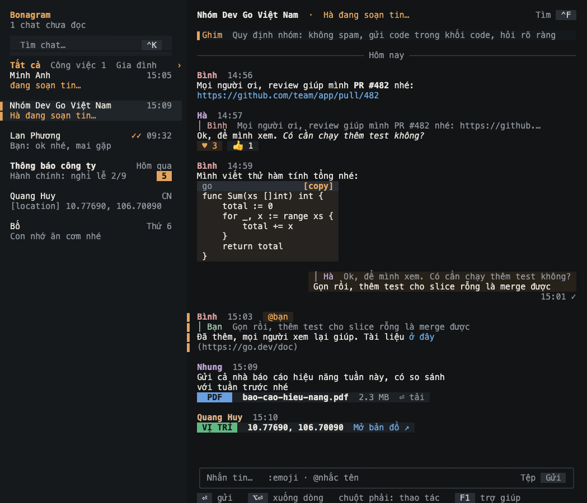
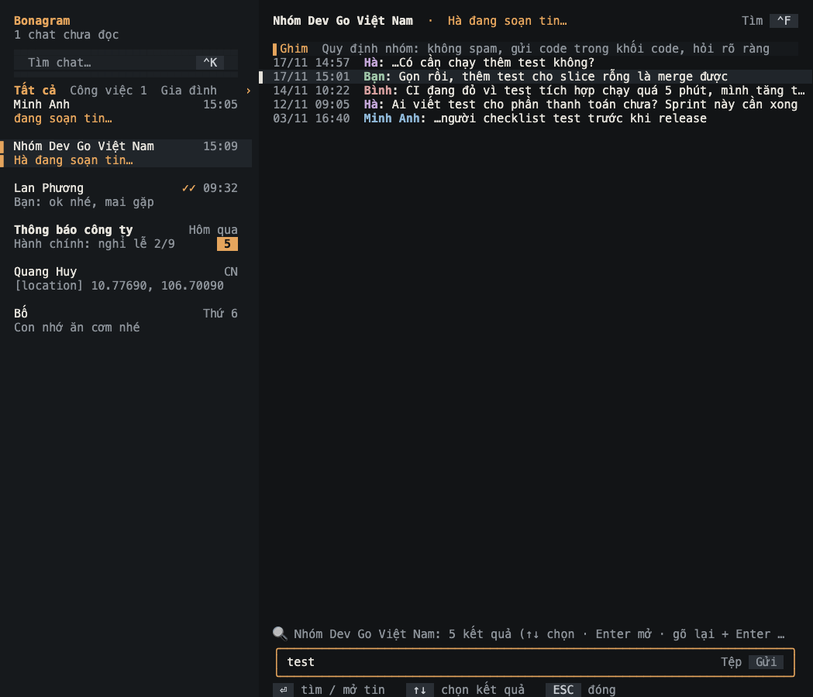
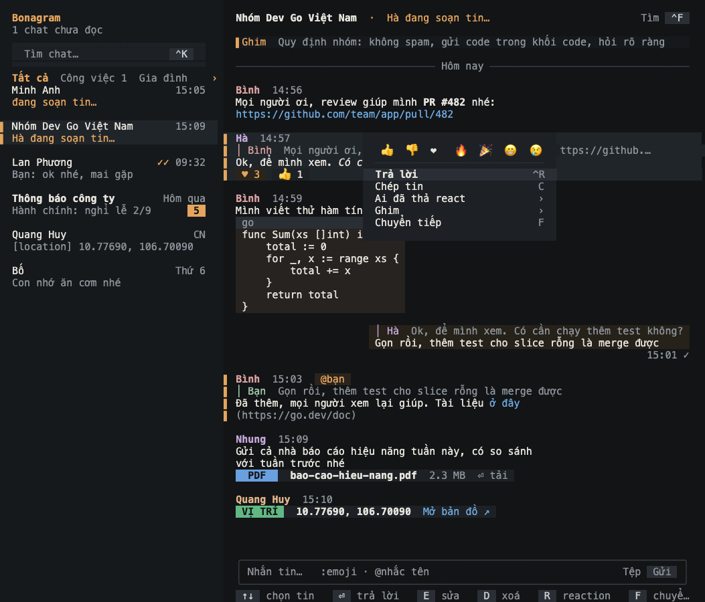
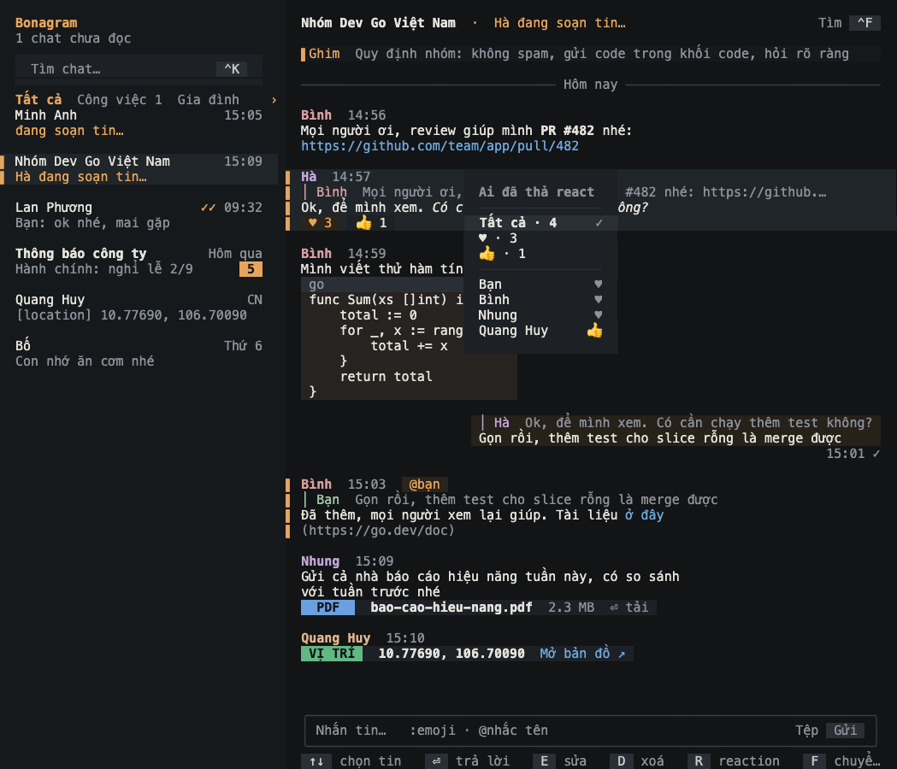
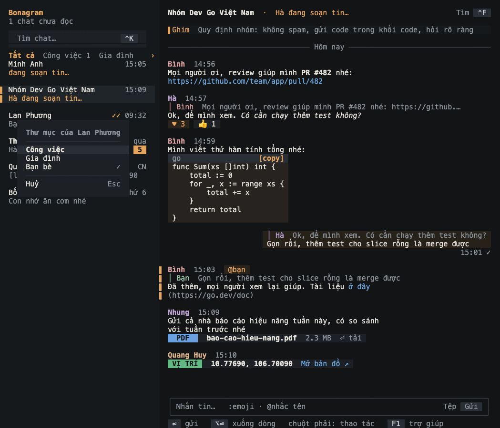
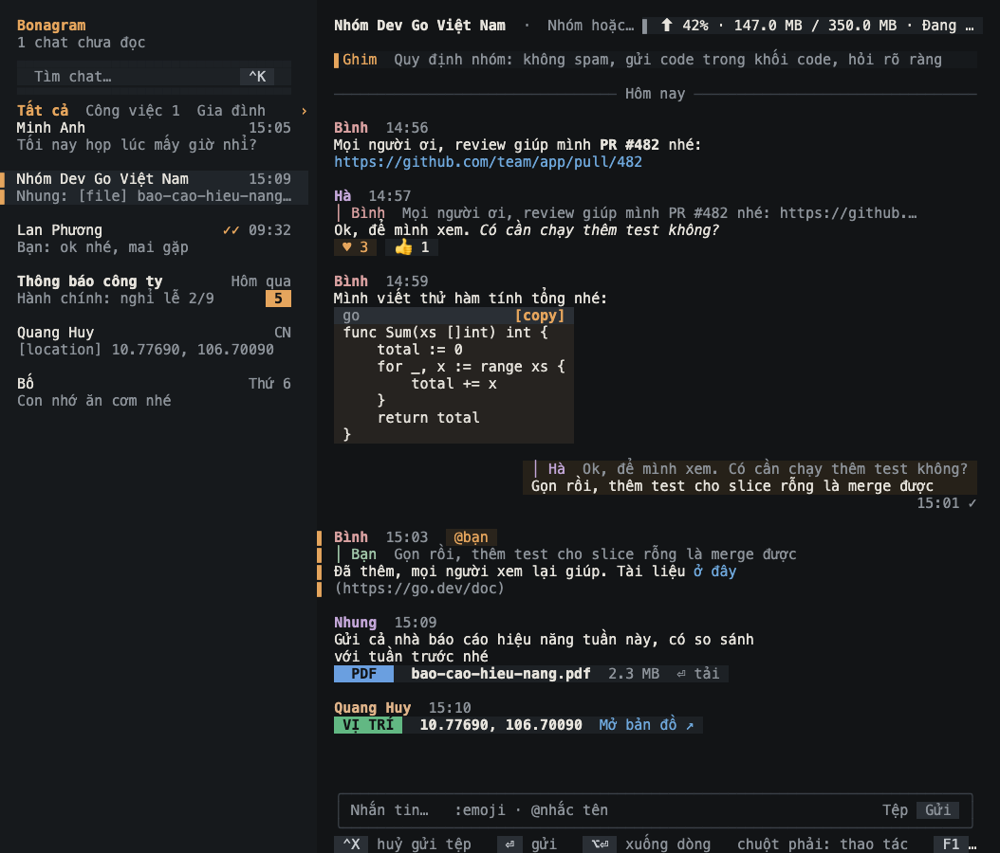
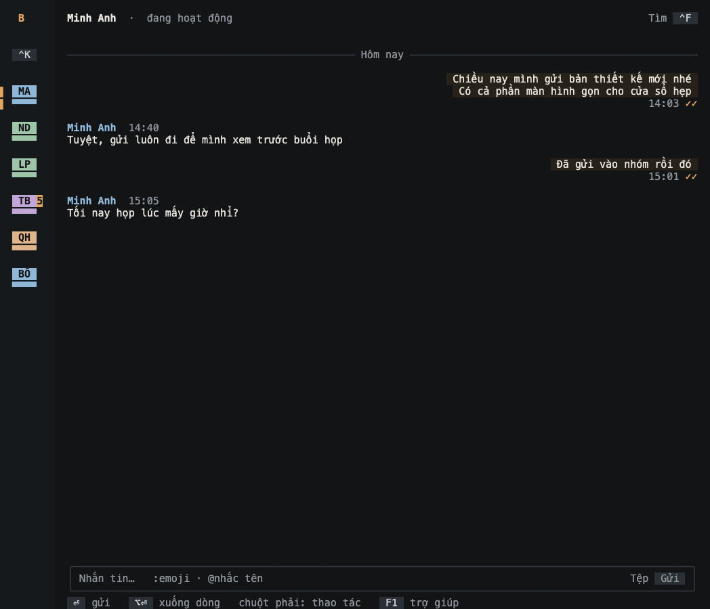

# bonagram

[English](README.md) | **Tiếng Việt**


**Telegram ngay trong một tab terminal.** Tin mới đến có chuông, thông báo desktop và số chưa đọc trên tiêu đề tab; bạn trả lời tại chỗ, không phải chuyển sang ứng dụng khác.

Viết bằng Go với [gotd/td](https://github.com/gotd/td) (kết nối Telegram) và [Bubble Tea](https://github.com/charmbracelet/bubbletea) (giao diện terminal). Đây là client **không chính thức**, đăng nhập bằng tài khoản Telegram của chính bạn. Chỉ một file chạy, không cần cài thêm gì.



*Dữ liệu mẫu (tên và tin nhắn giả), dựng từ chính giao diện của app bằng `scripts/shots.sh`: thư mục chat dạng tab, dấu đã xem (✓✓), "đang soạn tin…" trong danh sách và trên tiêu đề, trích dẫn khi trả lời, chữ định dạng, link, khối code, thẻ tệp và thẻ vị trí. Màu và font thật phụ thuộc terminal của bạn.*

<details>
<summary>Thêm ảnh: tìm tin, menu chuột phải, ai đã thả react, thư mục, gửi video, danh sách thu gọn</summary>

**Tìm trong nội dung chat bằng `Ctrl+F`**



**Chuột phải vào tin:** hàng reaction nhanh ở trên, các thao tác ở dưới



**Ai đã thả react**, có dòng lọc theo từng emoji



**Chuột phải vào chat › Thư mục:** thêm vào hoặc bỏ khỏi thư mục (✓ = đang ở trong)



**Gửi video:** tiến trình trên tiêu đề, `⌃X` để huỷ



**Danh sách thu gọn thành chữ viết tắt**, chat riêng có trạng thái online (*đang hoạt động*) và ✓✓



</details>

## Mục lục

- [Điểm nổi bật](#-điểm-nổi-bật)
- [Bắt đầu nhanh](#-bắt-đầu-nhanh)
- [Yêu cầu](#-yêu-cầu)
- [Cài đặt](#-cài-đặt) (có hướng dẫn [Linux](#linux) từng bước)
- [Đăng nhập lần đầu](#-đăng-nhập-lần-đầu)
- [Hướng dẫn sử dụng](#-hướng-dẫn-sử-dụng): danh sách chat, đọc tin, soạn và gửi, thao tác trên tin, ảnh, video và tệp
- [Phím tắt và chuột](#-phím-tắt-và-chuột)
- [Cấu hình](#-cấu-hình)
- [Terminal, tmux và clipboard](#-terminal-tmux-và-clipboard)
- [Dữ liệu và bảo mật](#-dữ-liệu-và-bảo-mật)
- [Xử lý sự cố](#-xử-lý-sự-cố)
- [Giới hạn](#-giới-hạn)
- [Hiệu năng](#-hiệu-năng)
- [Phát triển](#-phát-triển) · [Giấy phép](#-giấy-phép)

## ✨ Điểm nổi bật

- **Nhận tin ngay:** chuông, thông báo nhỏ trong app, thông báo desktop khi tab không được chọn, `(3) bonagram` trên tiêu đề tab. Chat tắt tiếng thì im lặng. Tin lỡ khi mất mạng được bù lại.
- **Nhắn tin như app chính thức:** trả lời, sửa, xoá, chuyển tiếp, reaction, ghim tin, nhắc tên `@`, gửi ảnh và tệp (nhiều tệp, có chú thích), gửi vị trí.
- **Ô soạn nhiều dòng:** định dạng `**đậm**` `__nghiêng__` `` `code` ``, gợi ý emoji khi gõ `:`, hoàn tác, gõ tiếng Việt Telex/VNI.
- **Chuột phải là có menu:** trên tin (reaction một click, trả lời, ghim, xoá…) và trên chat (ghim, tắt thông báo, xoá).
- **Biết ai đã đọc:** `✓` khi đã gửi, `✓✓` khi đã được đọc. Đọc trên điện thoại thì số chưa đọc trong app giảm theo.
- **Tìm nhanh:** tìm chat không cần gõ dấu (`dat` ra `Đạt`), tìm người hay nhóm chưa có trong danh sách, tìm trong nội dung chat.
- **Ảnh thật trong terminal** (Kitty, Ghostty), video phát bằng mpv, khối code có nút chép.
- **Gọn nhẹ:** khoảng 25 MB bộ nhớ, gần như không tốn CPU lúc để yên. Cửa sổ hẹp thì danh sách chat tự thu thành cột chữ viết tắt.

## 🚀 Bắt đầu nhanh

1. **Tải file chạy** ở [trang Releases](https://github.com/khoinguyenvk9/bonagram/releases), hoặc build: `go build -ldflags="-s -w" -o bonagram .`
2. **Lấy `api_id` và `api_hash`** ở <https://my.telegram.org> → *API development tools* (xem [Đăng nhập lần đầu](#-đăng-nhập-lần-đầu)).
3. **Chạy** `./bonagram`, nhập hai giá trị trên, số điện thoại và mã Telegram gửi về. Xong.

Trong app, bấm `F1` bất cứ lúc nào để xem hướng dẫn phím tắt. Dòng dưới cùng màn hình luôn ghi các phím dùng được lúc đó.

## 📋 Yêu cầu

Đánh dấu từng mục; mục nào chưa đạt thì làm theo cột bên phải.

| ☐ | Cần có | Kiểm tra bằng | Nếu chưa đạt |
|---|---|---|---|
| ☐ | **Go 1.26 trở lên** (chỉ khi build từ mã nguồn) | `go version` | Cài từ <https://go.dev/dl>. Go 1.21+ tự tải đúng phiên bản khi build (cần mạng) |
| ☐ | **Mạng vào được Telegram** | Mở được app Telegram chính thức trên cùng mạng | Dùng VPN. App **chưa hỗ trợ proxy** (SOCKS, MTProxy) |
| ☐ | **Tài khoản Telegram** cùng `api_id`, `api_hash` | Xem [Đăng nhập lần đầu](#-đăng-nhập-lần-đầu) | Tạo ở <https://my.telegram.org> |
| ☐ | **Terminal hỗ trợ màu 24-bit** | `echo $COLORTERM` ra `truecolor` hoặc `24bit` | Dùng Ghostty, Kitty, WezTerm, iTerm2, Alacritty… Terminal.app của macOS không hỗ trợ: màu sẽ sai |
| ☐ | **Terminal hỗ trợ chuột** | Click được vào chat sau khi mở app | Bật báo cáo chuột (mouse reporting) trong terminal |
| ☐ | **Locale UTF-8** (tiếng Việt, emoji) | `echo $LANG` có `UTF-8` | `export LANG=en_US.UTF-8` (hoặc `vi_VN.UTF-8`) |
| ☐ | **Cửa sổ từ 80×24 trở lên** | `tput cols; tput lines` | Nhỏ hơn vẫn chạy; dưới 76 cột danh sách chat thu thành cột chữ viết tắt |
| ☐ | (Linux) công cụ clipboard và mở tệp | `command -v xclip wl-copy xdg-open` | Xem mục [Linux](#linux): một dòng `apt`/`dnf`/`pacman` |
| ☐ | (Không bắt buộc) [mpv](https://mpv.io), một Nerd Font | `command -v mpv` | mpv để xem video trong terminal; Nerd Font cho biểu tượng trong menu (Ghostty, Kitty, WezTerm có sẵn) |

**Nền tảng:** macOS đã dùng thực tế (Apple Silicon). Linux (amd64, arm64) và Windows được build và chạy test trên GitHub Actions, nhưng chưa ai dùng với tài khoản thật ở đó. Windows chưa mở được tệp bằng ứng dụng ngoài.

**Terminal khuyến nghị:** **Ghostty** hoặc **Kitty**: ảnh thật, thông báo desktop, clipboard, biểu tượng có sẵn.

## 📦 Cài đặt

**File chạy dựng sẵn (không cần Go).** Tải gói cho máy bạn ở [trang Releases](https://github.com/khoinguyenvk9/bonagram/releases) (`darwin` = macOS, `arm64` = Apple Silicon / ARM, `amd64` = Intel/AMD), giải nén rồi chạy `bonagram` (`bonagram.exe` trên Windows). Đối chiếu bản tải về với `checksums.txt` nếu muốn. File chưa được ký số nên lần đầu có thể bị chặn:

- **macOS:** `xattr -d com.apple.quarantine ./bonagram` (hoặc chuột phải › Open trong Finder).
- **Windows:** SmartScreen báo "unknown publisher": chọn More info › Run anyway.

**Từ mã nguồn:**

```bash
go build -ldflags="-s -w" -o bonagram .
./bonagram
```

Gắn số phiên bản vào file chạy (để báo lỗi đúng bản): `go build -ldflags="-s -w -X main.version=<phiên-bản>" -o bonagram .`

Muốn gọi từ mọi thư mục thì chép `bonagram` vào một thư mục trong `PATH`, ví dụ `~/.local/bin`.

| Lệnh | Tác dụng |
|---|---|
| `bonagram` | Mở app |
| `bonagram --version` (`-v`) | In phiên bản, bản Go và nền tảng |
| `bonagram --help` (`-h`) | In cách dùng ngắn |

Tuỳ chọn không hợp lệ thì app báo lỗi và thoát với mã 2.

### Linux

File chạy cho Linux là file tĩnh: chạy được trên mọi bản Linux (Ubuntu, Debian, Fedora, Arch, Alpine…) mà không cần cài thư viện nào. Tải bản mới nhất đúng loại CPU, kiểm tra rồi đặt vào `~/.local/bin`:

```bash
ver=$(curl -fsSL https://api.github.com/repos/khoinguyenvk9/bonagram/releases/latest | sed -n 's/.*"tag_name": *"v\([^"]*\)".*/\1/p')
case "$(uname -m)" in x86_64) arch=amd64 ;; aarch64 | arm64) arch=arm64 ;; esac
name="bonagram_${ver}_linux_${arch}"
cd "$(mktemp -d)"
curl -fLO "https://github.com/khoinguyenvk9/bonagram/releases/download/v${ver}/${name}.tar.gz"
curl -fLO "https://github.com/khoinguyenvk9/bonagram/releases/download/v${ver}/checksums.txt"
grep " ${name}.tar.gz$" checksums.txt | sha256sum -c -
tar xzf "${name}.tar.gz"
mkdir -p ~/.local/bin && install -m 755 "${name}/bonagram" ~/.local/bin/bonagram
~/.local/bin/bonagram --version
```

Nếu sau đó gõ `bonagram` báo "command not found" thì `~/.local/bin` chưa có trong `PATH`: thêm `export PATH="$HOME/.local/bin:$PATH"` vào `~/.bashrc` (hoặc `~/.zshrc`) rồi mở terminal mới. Muốn cập nhật thì chạy lại đúng các dòng trên.

Bản thân app không cần gì thêm; các công cụ sau bật những phần làm việc với máy tính (đều không bắt buộc):

| Để làm gì | Debian / Ubuntu | Fedora | Arch |
|---|---|---|---|
| Chép (X11 / Wayland) | `xclip` / `wl-clipboard` | `xclip` / `wl-clipboard` | `xclip` / `wl-clipboard` |
| Mở link và tệp | `xdg-utils` | `xdg-utils` | `xdg-utils` |
| Hộp chọn tệp (`Ctrl+O`, nút kẹp giấy) | `zenity` (KDE: `kdialog`) | `zenity` | `zenity` |
| Phát video trong terminal | `mpv` | `mpv` | `mpv` |
| Ảnh bìa khi gửi video | `ffmpeg` | `ffmpeg-free` | `ffmpeg` |

```bash
sudo apt install xclip wl-clipboard xdg-utils zenity mpv ffmpeg          # Debian, Ubuntu, Mint
sudo dnf install xclip wl-clipboard xdg-utils zenity mpv ffmpeg-free     # Fedora
sudo pacman -S xclip wl-clipboard xdg-utils zenity mpv ffmpeg            # Arch, Manjaro
```

**Terminal:** GNOME Terminal, Konsole, Alacritty, WezTerm, Kitty và Ghostty đều có màu 24-bit và chuột. Kitty và Ghostty vẽ ảnh thật ở mọi chỗ; WezTerm, Konsole và foot vẽ ảnh thật khi mở xem (trong khung chat là khối màu); GNOME Terminal, Alacritty và tmux dùng khối màu (chi tiết ở mục [Terminal](#-terminal-tmux-và-clipboard)). Chép vẫn chạy khi không có `xclip`/`wl-clipboard` nếu terminal nhận OSC 52 (Kitty, Ghostty, WezTerm…).

**Build từ mã nguồn trên Linux:** Go của bản Linux dùng được kể cả khi cũ hơn 1.26 (Ubuntu 24.04 có 1.22): lần build đầu nó tự tải đúng bản Go dự án cần.

```bash
sudo apt install golang-go git        # hoặc: dnf install golang git / pacman -S go git
git clone https://github.com/khoinguyenvk9/bonagram && cd bonagram
go build -ldflags="-s -w" -o bonagram . && install -m 755 bonagram ~/.local/bin/
```

Thông tin đăng nhập và cài đặt nằm ở `~/.config/bonagram/` (`session.json` cho toàn quyền vào tài khoản: giữ kín); ảnh đã tải được lưu tạm ở `~/.cache/bonagram/`. Gỡ cài đặt: `rm ~/.local/bin/bonagram`, thêm `rm -r ~/.config/bonagram ~/.cache/bonagram` để đăng xuất máy này ở phía app (máy vẫn hiện trong Telegram › Cài đặt › Thiết bị cho tới khi bạn kết thúc phiên ở đó).

## 🔑 Đăng nhập lần đầu

**Lấy `api_id` và `api_hash`:**

1. Vào <https://my.telegram.org>, đăng nhập bằng số điện thoại Telegram của bạn.
2. Chọn **API development tools**, tạo một ứng dụng (tên và mô tả điền tuỳ ý).
3. Chép **App api_id** (một số) và **App api_hash** (chuỗi dài). Hai giá trị này là của riêng bạn: không chia sẻ, không đưa lên git.

**Chạy `./bonagram`:** nhập `api_id`, `api_hash`, rồi số điện thoại, mã Telegram gửi về và mật khẩu hai bước nếu có. Số bắt đầu bằng `0` được hiểu là số **Việt Nam** (đổi thành `+84…`); số nước khác gõ đủ dạng `+<mã quốc gia>…`. Các lần sau app mở thẳng, không hỏi lại. Lần đầu app tự mở hướng dẫn phím tắt (`F1`).

Nên mở app trong một tab terminal riêng và để đó. Thoát bằng `Ctrl+Q`.

Cấu hình và phiên đăng nhập nằm trong `~/.config/bonagram/`:

| File | Nội dung |
|---|---|
| `env` | `api_id`, `api_hash` và các tuỳ chọn (xem [Cấu hình](#-cấu-hình)) |
| `session.json` | Phiên đăng nhập: **quyền truy cập đầy đủ vào tài khoản**, giữ kín |
| `width` | Độ rộng danh sách chat; `8` nghĩa là đang thu gọn |
| `help-seen` | Đánh dấu đã mở hướng dẫn lần đầu (xoá đi thì lần sau hiện lại) |

## 💬 Hướng dẫn sử dụng

> Trên macOS, phím tắt được ghi theo kiểu Mac: `⌃` là Control, `⌥` là Option, `⏎` là Return. Ví dụ `⌃K` = `Ctrl+K`.

### Danh sách chat

- **Mở chat:** click, hoặc `Ctrl+N` / `Ctrl+P` để sang chat kế tiếp / trước, `Ctrl+G` để nhảy tới chat có tin chưa đọc.
- **Thư mục:** các thư mục chat của Telegram là các tab ngay trên danh sách, kèm số chat chưa đọc; click hoặc `Ctrl+L` để sang thư mục kế tiếp. Không đủ chỗ thì `‹` / `›` báo còn thư mục bị khuất: click mũi tên hoặc lăn chuột trên hàng tab để cuộn. Tìm chat thì tìm trong mọi chat, không theo thư mục. Thư mục sửa trên thiết bị khác thì cập nhật ngay.
- **Trên mỗi dòng:** `✓` / `✓✓` cạnh giờ khi tin mới nhất là của bạn (đã gửi / đã xem); *đang soạn tin…* thay cho tin cuối khi người kia đang gõ, hoặc việc họ đang làm (đang ghi âm, đang gửi ảnh…).
- **Trên khung tin:** trạng thái online cạnh tên người (*đang hoạt động*, *hoạt động 5 phút trước*…), hoặc ai đang gõ; nhóm có topic thì chỉ hiện người gõ trong topic đang mở. Khi bạn gõ, bên kia thấy bạn đang soạn tin (trừ Saved Messages và kênh).
- **Tìm chat:** `Ctrl+K` hoặc click ô tìm. Không cần gõ dấu (`dat` ra `Đạt`), tìm cả theo username. Gõ từ 3 chữ trở lên thì người, nhóm, kênh **trên Telegram** (theo tên hoặc `@username`) hiện dưới các kết quả, ghi "tìm trên Telegram": chọn là mở thành chat mới, để nhắn cho người chưa có trong danh sách.
- **Chuột phải vào một chat:**
  - **Ghim lên đầu** / Bỏ ghim chat (tài khoản thường ghim tối đa 5 chat).
  - **Tắt thông báo** / Bật thông báo (tắt hẳn cho tới khi bật lại).
  - **Thư mục ›**: danh sách thư mục, `✓` ở thư mục đang chứa chat; chọn để thêm chat vào hoặc bỏ ra. Chat mà thư mục lấy theo loại (ví dụ mọi nhóm) thì bỏ ra nghĩa là loại trừ riêng chat đó. Thư mục chia sẻ thì sửa trong app Telegram. Chưa tạo, đổi tên hay xoá thư mục được ở đây.
  - **Xoá chat** (chat riêng): *Chỉ xoá phía tôi* hoặc *Xoá cho cả hai bên*, không hoàn tác được.
  - **Rời nhóm** (nhóm và kênh). Saved Messages không xoá được từ đây.
- **Nhóm có topic (forum):** mỗi topic là một tab, có số chưa đọc riêng; `Ctrl+T` / `Ctrl+Y` để đổi topic.
- **Đổi độ rộng:** kéo thanh dọc giữa danh sách và khung tin (được nhớ). Kéo hẳn sang trái thì danh sách **thu thành cột chữ viết tắt** như Telegram: mỗi chat một ô màu, số chưa đọc cạnh ô, rê chuột để xem tên; kéo ra lại để mở. Cửa sổ quá hẹp (dưới 76 cột với độ rộng mặc định) thì danh sách tự thu gọn; `Ctrl+K` mở lại danh sách đầy đủ cho tới khi chọn xong chat.
- Chat ghim luôn ở trên cùng; chat lưu trữ (Archived) bị ẩn, giống Telegram.

### Đọc tin

- **Tin của bạn** nằm trong khối nền ấm bên phải, kèm `✓` (đã gửi) hoặc `✓✓` (đã được đọc; trong nhóm là khi có người đọc). Mỗi ngày bắt đầu bằng dòng `─── Hôm nay ───`.
- **Tin trả lời** có dòng trích dẫn `│ Tên  nội dung` phía trên. **Click vào trích dẫn** để nhảy tới tin gốc (được tô sáng; tin cũ hơn thì app tải đoạn tin quanh nó, `Esc` để về tin mới nhất).
- **Tin ghim:** dòng *Ghim* ở đầu chat là tin ghim mới nhất (`Ghim 1/3` khi có nhiều). Click để nhảy tới tin đó; click tiếp để đi qua các tin ghim cũ hơn.
- **Tìm trong chat:** `Ctrl+F`, gõ từ khoá rồi `⏎`; `↑` `↓` chọn kết quả, `⏎` mở đoạn tin quanh nó, `Esc` đóng. Tối đa 50 kết quả, mới nhất trước.
- **Tin cũ hơn:** cuộn lên đầu (hoặc `PgUp`) để tải thêm, tối đa `BONAGRAM_MAX_MESSAGES` tin.
- **Link** màu xanh, rê chuột thì gạch chân, click để mở. Link ẩn sau chữ được ghi kèm địa chỉ.
- **Hiển thị đầy đủ:** chữ đậm, nghiêng, gạch chân, gạch ngang, chữ ẩn, code, mention, hashtag; reaction thành các ô nhỏ (của bạn tô màu hổ phách); tin hệ thống viết thành chữ (ai tham gia, rời nhóm, đổi tên nhóm, cuộc gọi…). Câu trả lời bot gửi dần (sửa dần một tin) hiện trực tiếp.
- **Đã đọc:** mở chat là đánh dấu đã đọc, giống app chính thức. Đọc trên điện thoại thì số chưa đọc trong app giảm theo ngay.

### Soạn và gửi

- **Gửi:** gõ rồi `⏎`. **Xuống dòng:** `⌥⏎` (Alt+Enter) hoặc `Ctrl+J`. Ô soạn cao dần tới 6 dòng rồi cuộn; dán văn bản nhiều dòng giữ nguyên các dòng. Phần lớn terminal gửi `Shift+Enter` giống `Enter`; nếu cài terminal gửi `Shift+Enter` thành `Alt+Enter` (iTerm2, Ghostty, Kitty đều được) thì `Shift+Enter` cũng xuống dòng.
- **Trả lời:** `Ctrl+R` (tin mới nhất), hoặc chọn tin rồi `⏎`, hoặc chuột phải › Trả lời. `Esc` để huỷ.
- **Emoji:** gõ `:` đầu một từ và ít nhất 2 chữ (`:haha`, `:camon`, `:tim`, `:like`, `:pho`): `←` `→` chọn, `Tab` hoặc `⏎` chèn. Tên có tiếng Anh và tiếng Việt không dấu.
- **Nhắc tên:** trong nhóm, gõ `@` ở đầu một từ để hiện danh sách thành viên; `↑` `↓` chọn, `Tab` hoặc `⏎` chèn. Người không có username vẫn nhận được thông báo. Vài nhóm lớn ẩn danh sách thành viên; khi đó app báo không đọc được.
- **Định dạng** (gõ ký hiệu, giống Telegram):

  | Gõ | Kết quả |
  |---|---|
  | `**đậm**` | **đậm** |
  | `__nghiêng__` | _nghiêng_ |
  | `~~gạch~~` | ~~gạch~~ |
  | `\|\|ẩn\|\|` | chữ ẩn (spoiler) |
  | `` `code` `` | code trong dòng |
  | ```` ```go ```` xuống dòng, code, xuống dòng ```` ``` ```` | khối code (ngôn ngữ không bắt buộc) |
  | `[chữ](https://địa-chỉ)` | link nằm sau chữ |

  `*` và `_` đơn lẻ không phải ký hiệu, nên `snake_case` và `2*3` an toàn; đặt `\` trước ký hiệu để gõ nguyên văn. Khi sửa tin (`E`), định dạng được đổi lại thành ký hiệu nên không bị mất.
- **Sửa gõ nhanh:** `Ctrl+Z` hoàn tác, `Ctrl+W` xoá một từ, `Ctrl+U` xoá tới đầu dòng, `Home` `End` (hoặc `Ctrl+A` `Ctrl+E`) về đầu, cuối dòng, `⌥←` `⌥→` nhảy từng từ, click để đặt con trỏ.
- **Gửi ảnh và tệp** (một hoặc nhiều, kèm chú thích):
  1. Chọn tệp: bấm nút **kẹp giấy** (hoặc chữ `Tệp`) ở cuối ô soạn hoặc `Ctrl+O` để mở hộp chọn tệp; hoặc gõ `/file ~/Downloads/bao-cao.pdf ~/Pictures/a.png`; hoặc kéo tệp từ Finder thả vào terminal (terminal dán đường dẫn) rồi dùng `/file`.
  2. Các tệp hiện ở dòng trên ô soạn. Gõ chú thích nếu muốn, `⏎` để gửi, `Esc` để bỏ.

  Ảnh jpg/png dưới 10 MB gửi dạng ảnh; mp4/mov/m4v gửi dạng video xem được ngay trong Telegram (thời lượng và khung hình đọc từ tệp, có ảnh bìa nếu máy cài `ffmpeg`); còn lại dạng tệp. Ảnh và video gộp chung album. Nhiều tệp được gộp thành album tối đa 10, chú thích ở tệp đầu. Đang trả lời một tin thì tệp gửi kèm làm trả lời. Trong lúc gửi, thanh tiêu đề hiện đã gửi được bao nhiêu (phần trăm và MB); tệp vượt giới hạn của Telegram (2000 MB, 4000 MB với Premium) bị từ chối ngay, trước khi tải lên. `Ctrl+X` huỷ lần gửi đang chạy (album trước đó của cùng lần gửi đã đi thì vẫn ở lại). Trên Linux hộp chọn tệp cần `zenity` hoặc `kdialog`.
- **Gửi vị trí:** `/position 10.7769, 106.7009` (hoặc `/vitri`), hoặc dán link Google Maps có toạ độ.
- **Nháp:** chữ gõ dở được giữ riêng cho từng chat và topic khi bạn chuyển đi; thoát app thì mất.

### Thao tác trên tin

**Chuột phải vào một tin** để mở menu:

- Hàng trên cùng là **7 reaction**: click một emoji (hoặc phím `1`…`7`) là thả ngay; emoji đã thả có nền khác, click lại để gỡ.
- Bên dưới là các thao tác, mỗi mục có biểu tượng và phím tắt tương ứng: **Trả lời, Xem ảnh / Tải tệp, Chép, Mở link, Chép link, Ghim, Chuyển tiếp, Sửa, Xoá** (Sửa và Xoá chỉ với tin của bạn).
- **Ai đã thả react ›** (tin có react): từng người kèm emoji họ thả, các dòng trên cùng để lọc theo một emoji; click vào tên để mở chat với người đó. Không ai được báo là bạn đã xem. Trong nhóm, Telegram chỉ cho xem với nhóm nhỏ (nhóm lớn thì không có mục này), kênh thì không bao giờ; tải tối đa 100 người, nhiều hơn thì tiêu đề ghi rõ.
- **Ghim** mở menu con: trong nhóm chọn *Ghim và báo cho mọi người* hoặc *Ghim im lặng* (cần quyền admin); trong chat riêng chọn *Ghim cho cả hai bên* hoặc *Chỉ ghim cho tôi*. Tin đang ghim thì mục này là *Bỏ ghim*.
- **Xoá** hỏi lại *Xoá với mọi người*. Không hoàn tác được.
- **Chuyển tiếp:** sau khi chọn, click chat đích ở danh sách bên trái (hoặc gõ tìm rồi `⏎`).

**Bằng bàn phím:** `Ctrl+B` (hoặc click một tin) để chọn tin, `↑` `↓` di chuyển, rồi:

| Phím | Tác dụng |
|---|---|
| `⏎` | Trả lời; trên ảnh thì xem to, trên tệp thì tải về |
| `C` | Chép khối code (bấm tiếp: khối kế); tin không có code thì chép cả tin |
| `E` | Sửa tin của bạn: `⏎` lưu, `Esc` huỷ |
| `D` | Xoá tin của bạn: `Y` để xác nhận, phím khác là giữ |
| `R` | Thả reaction: bấm `1`…`7` (👍 👎 ❤ 🔥 🎉 😁 😢); bấm lại reaction đã thả để gỡ |
| `F` | Chuyển tiếp: chọn chat đích, `⏎` gửi; đích là nhóm forum thì vào topic General |
| `O` / `L` | Mở link (bấm tiếp: link kế) / chép mọi link của tin, kể cả link ẩn |
| `M` | Nhảy lên @mention gần nhất trong các tin đã tải |
| `Esc` | Thôi chọn tin |

**Bôi đen chữ:** kéo chuột qua chữ trong tin, thả ra là chữ được chép.

### Ảnh, video và tệp

**Ảnh** (`⏎` hoặc click để xem to; `Esc`/`Q` đóng, `O` mở bằng ứng dụng hệ thống):

| Terminal | Trong danh sách tin | Xem toàn màn hình |
|---|---|---|
| Kitty, Ghostty | ảnh thật | ảnh thật |
| iTerm2, WezTerm, mintty, Rio, VS Code | khối màu | ảnh thật (giao thức iTerm2) |
| foot, Windows Terminal 1.22+, Konsole, mlterm, contour | khối màu | ảnh thật (Sixel) |
| Terminal.app, Alacritty, GNOME Terminal, tmux, khác | khối màu | khối màu |

Mới thử thật trên Kitty và Ghostty; các dòng khác theo tài liệu của từng terminal. Đoán sai thì đặt `BONAGRAM_IMAGES`. Ảnh nhỏ ngay trong khung chat bật bằng `BONAGRAM_PREVIEWS=1`; ảnh gửi dạng tệp (không nén) cũng có ảnh nhỏ, lấy từ bản thu nhỏ Telegram lưu sẵn (tệp gốc chỉ tải khi nhấn Enter). Sticker tĩnh được vẽ thành hình; sticker động là nhãn.

**Video và GIF:** `⏎` tải về rồi phát ngay trong terminal nếu máy có [mpv](https://mpv.io) (`q` để quay lại app); không có mpv thì mở bằng trình phát của hệ thống. Cài: `brew install mpv`, `apt install mpv` hoặc `winget install mpv`.

**Tệp** hiện thành một dòng `PDF  tên tệp  2.3 MB  ⏎ tải`. `⏎` tải vào thư mục **Downloads**, trong lúc tải thanh tiêu đề hiện phần trăm và MB (`Ctrl+X` huỷ và xoá phần đã tải dở) (tệp trùng tên và cùng dung lượng thì dùng lại, khác thì thành `tên (1).đuôi`). Loại quen thuộc (ảnh, video, âm thanh, PDF, văn bản, Office) được mở bằng ứng dụng hệ thống; loại khác chỉ được chỉ ra trong trình quản lý tệp, **không bao giờ tự chạy**, vì mở bừa một tệp từ chat có thể chạy mã. Liên kết tệp hết hạn thì app tự lấy lại.

**Vị trí** hiện thành một dòng có link *Mở bản đồ ↗* (Google Maps).

**Tin thoại:** `⏎` tải về và mở bằng ứng dụng hệ thống; QuickTime trên macOS thường không phát được định dạng `.ogg` này.

## ⚡ Phím tắt và chuột

`F1` mở hướng dẫn ngay trong app. Dòng dưới cùng màn hình luôn ghi phím của chế độ đang dùng.

**Chung**

| Phím | Tác dụng |
|---|---|
| `Ctrl+K` | Tìm chat (và người, nhóm trên Telegram) |
| `Ctrl+N` / `Ctrl+P` | Chat kế tiếp / trước |
| `Ctrl+G` | Chat có tin chưa đọc |
| `Ctrl+T` / `Ctrl+Y` | Topic kế tiếp / trước |
| `Ctrl+L` | Thư mục chat kế tiếp |
| `Ctrl+F` | Tìm trong nội dung chat |
| `Ctrl+B` | Chọn tin (xem [Thao tác trên tin](#thao-tác-trên-tin)) |
| `PgUp` / `PgDn` | Cuộn khung tin |
| `F1` | Hướng dẫn |
| `Ctrl+Q` | Thoát |

**Khi soạn tin**

| Phím | Tác dụng |
|---|---|
| `⏎` | Gửi |
| `Alt+Enter` / `Ctrl+J` | Xuống dòng |
| `Ctrl+R` | Trả lời tin mới nhất |
| `Ctrl+O` | Chọn tệp để gửi |
| `Ctrl+X` | Huỷ gửi / tải tệp đang chạy |
| `↑` `↓`, `Home` `End`, `Alt+←` `Alt+→` | Di chuyển trong ô soạn |
| `Ctrl+Z` / `Ctrl+W` / `Ctrl+U` | Hoàn tác / xoá một từ / xoá tới đầu dòng |
| `:tên` / `@tên` | Gợi ý emoji / nhắc tên |
| `Esc` | Huỷ trả lời, huỷ sửa, bỏ tệp đã chọn |

**Chuột**

| Thao tác | Tác dụng |
|---|---|
| Click chat, tab topic | Mở |
| Click tin | Chọn tin; ảnh thì mở ngay, tệp thì chỉ chọn (`⏎` để tải) |
| Click link, `[copy]`, dòng Ghim, trích dẫn | Mở link, chép code, nhảy tới tin ghim, nhảy tới tin gốc |
| Chuột phải vào tin / vào chat | Menu thao tác |
| Kéo chuột qua chữ | Bôi đen và chép |
| Kéo thanh dọc | Đổi độ rộng danh sách; kéo hẳn sang trái để thu gọn |
| Cuộn | Cuộn danh sách hoặc khung tin; lên đầu thì tải tin cũ |

Terminal không báo phím `Cmd`, nên trong app click thường là đủ để mở link.

## 🔧 Cấu hình

Đặt trong `~/.config/bonagram/env` (mỗi dòng `KHOÁ=giá trị`) hoặc bằng biến môi trường; file `env` được ưu tiên. Giá trị sai thì dùng mặc định, ngoài khoảng thì lấy cận gần nhất.

```
TG_API_ID=1234567
TG_API_HASH=<api_hash 32 ký tự của bạn>

# Tuỳ chọn (đây là giá trị mặc định)
BONAGRAM_MAX_MESSAGES=500
BONAGRAM_PREVIEWS=0
BONAGRAM_PREVIEW_ROWS=8
BONAGRAM_PREVIEW_COUNT=8
BONAGRAM_FPS=60
```

| Khoá | Mặc định | Ý nghĩa |
|---|---|---|
| `TG_API_ID`, `TG_API_HASH` | bắt buộc | Thông tin API |
| `BONAGRAM_MAX_MESSAGES` | `500` (40–5000) | Số tin tối đa tải khi cuộn lên xem lịch sử |
| `BONAGRAM_PREVIEWS` | `0` | `1` để hiện ảnh nhỏ ngay trong khung chat |
| `BONAGRAM_PREVIEW_ROWS` | `8` (0–30) | Chiều cao tối đa của ảnh nhỏ, tính bằng dòng |
| `BONAGRAM_PREVIEW_COUNT` | `8` (0–50) | Chỉ N ảnh mới nhất của chat có ảnh nhỏ |
| `BONAGRAM_IMAGES` | tự nhận | `kitty`, `iterm`, `sixel` hoặc `blocks`: ép cách vẽ ảnh |
| `BONAGRAM_FPS` | `60` (10–120) | Khung hình tối đa mỗi giây; thấp hơn thì tốn ít CPU hơn nhưng kém mượt |
| `BONAGRAM_ICONS` | bật | `off` để bỏ biểu tượng trong menu (khi font của terminal không phải Nerd Font: biểu tượng hiện thành ô vuông) |

## 💻 Terminal, tmux và clipboard

**tmux:** thêm vào `~/.tmux.conf` rồi `tmux source ~/.tmux.conf`. Trong tmux, ảnh luôn hiện bằng khối màu.

```
set -g default-terminal "tmux-256color"
set -ga terminal-overrides ",*:RGB"   # màu 24-bit
set -g set-clipboard on               # nút copy
set -g focus-events on                # thông báo và đánh dấu đã đọc đúng lúc
set -g mouse on
```

**Clipboard:** nút `[copy]` và bôi đen chữ dùng chuỗi OSC 52 (Ghostty, Kitty, WezTerm, iTerm2; chạy được cả qua SSH), kèm `pbcopy` (macOS), `wl-copy` hoặc `xclip` nếu có. Terminal.app chỉ chép được nhờ `pbcopy`.

**Link:** mỗi link còn là hyperlink OSC 8, nên terminal có hỗ trợ (iTerm2, Ghostty, Kitty, WezTerm, Windows Terminal, GNOME Terminal, Konsole, Alacritty) mở được bằng `Cmd`/`Ctrl`+click. Terminal.app, xterm không hỗ trợ; tmux cần bản 3.4+ và `set -as terminal-features ',*:hyperlinks'`. Click thường trong app vẫn luôn dùng được.

**Thông báo và đã đọc** cần terminal báo khi cửa sổ được chọn (focus). Terminal không báo thì app coi như cửa sổ luôn đang được xem.

**Gõ tiếng Việt:** chữ đang soạn của bộ gõ (Telex/VNI) hiện ở đúng chỗ con trỏ nếu terminal vẽ nó tại vị trí con trỏ thật. Chưa kiểm tra trên mọi terminal.

## 🔒 Dữ liệu và bảo mật

- `~/.config/bonagram/session.json` **là quyền truy cập đầy đủ vào tài khoản Telegram của bạn.** Ai có file này đọc và gửi tin được như bạn. Không chia sẻ, không đưa lên git.
- `~/.config/bonagram/env` chứa `api_hash`; app tạo file với quyền `600`.
- App chỉ nói chuyện với server Telegram, không gửi dữ liệu đi nơi khác.
- Tên và nội dung nhận từ Telegram được lọc ký tự điều khiển trước khi hiển thị, nên người gửi không chèn được lệnh vào terminal của bạn.
- Tệp tải về không bao giờ được tự chạy.

## 🆘 Xử lý sự cố

| Triệu chứng | Cách xử lý |
|---|---|
| Báo `API_ID_INVALID` | `api_id`/`api_hash` sai: sửa trong `~/.config/bonagram/env` hoặc xoá file đó để nhập lại |
| Kẹt khi kết nối | Kiểm tra mạng và VPN. App chưa hỗ trợ proxy |
| Số điện thoại báo sai | Số bắt đầu bằng `0` bị đổi thành `+84…`; số nước khác gõ đủ `+<mã quốc gia>…` |
| Không thấy chat lưu trữ | Chủ ý: chat Archived bị ẩn |
| Ảnh không hiện hoặc méo | Đặt `BONAGRAM_IMAGES=blocks`. Trong tmux ảnh luôn là khối màu |
| Màu sai, xám xịt | Terminal không có màu 24-bit: kiểm tra `echo $COLORTERM` hoặc đổi terminal |
| Biểu tượng trong menu hiện ô vuông | Đặt font terminal là một Nerd Font, hoặc `BONAGRAM_ICONS=off` |
| Tiếng Việt, emoji hiện ô vuông hoặc lệch | Kiểm tra locale UTF-8 và font |
| `[copy]` không chép được | Terminal không hỗ trợ OSC 52; trong tmux bật `set -g set-clipboard on` |
| Danh sách chat tự thu gọn | Cửa sổ dưới 76 cột, hoặc đã kéo thanh dọc hẳn sang trái: kéo ra lại (hoặc xoá `~/.config/bonagram/width`) |
| Chữ đang soạn của bộ gõ hiện sai chỗ | Báo lỗi kèm tên bộ gõ và terminal |
| Còn tiến trình `bonagram` sau khi thoát | `pkill bonagram` (tiến trình sót vẫn giữ phiên mở); báo lỗi kèm cách đã thoát |
| Đăng xuất | Xoá `~/.config/bonagram/session.json`, hoặc chấm dứt phiên trong Telegram › Settings › Devices |
| Làm lại từ đầu | Xoá cả thư mục `~/.config/bonagram/` |

## 🚧 Giới hạn

**Chưa hỗ trợ:** gửi tin thoại, sticker, GIF; phát tin thoại trong app; chat bí mật (secret chat), cuộc gọi, story; xem chat lưu trữ; proxy; nhiều tài khoản cùng lúc (đổi tài khoản: xoá `session.json`).

**Thay đổi làm trên máy khác** được cập nhật trực tiếp với tin mới, tin bị sửa, reaction và trạng thái đã đọc. Riêng các thay đổi sau chỉ hiện khi mở lại chat hoặc app: ghim/bỏ ghim tin hay chat, tắt thông báo, chat lưu trữ có tin mới. Tin bị người khác xoá **cố ý** vẫn được giữ trên màn hình tới khi mở lại app, để bạn đọc được tin đã gửi rồi xoá.

**Dữ liệu được tải:** tối đa 1.000 chat; mỗi lần mở chat 40 tin gần nhất, cuộn lên tải thêm tới `BONAGRAM_MAX_MESSAGES` (tối đa 5.000); tối đa 100 topic mỗi nhóm forum; 20 tin ghim mỗi chat.

**Khác:**
- Reaction chỉ có 7 emoji cố định; chat không cho emoji đó (ví dụ Saved Messages) thì Telegram từ chối và app báo lỗi.
- Chuyển tiếp từng tin một, giữ tên người gửi gốc. Tệp gửi đi và tin chuyển tiếp hiện sau vài giây, khi app tải lại chat.
- Telegram giới hạn 4.096 ký tự mỗi tin. Chú thích của tệp được gửi nguyên ký hiệu như đã gõ (chưa đổi thành định dạng).
- Giao diện chỉ có tiếng Việt, một bảng màu tối cố định.
- App hiện thành một thiết bị mới trong Telegram › Settings › Devices. Đăng nhập nhiều lần liên tiếp có thể bị tạm khoá gửi mã (FLOOD_WAIT): chờ rồi thử lại.
- App giữ chuột, nên bôi đen chữ do app làm thay terminal.

## 📊 Hiệu năng

**Vẽ màn hình** (benchmark trên dữ liệu giả, `bench_test.go`, Apple Silicon; chat 500 tin, tin nào cũng là trả lời, có link và định dạng):

| Bước | v0.1.0 | v0.2.1 | v0.3.0 |
|---|---|---|---|
| Vẽ lại cả chat (khi có tin mới) | 2,1 ms | 2,3 ms | **1,15 ms** |
| Một khung hình (cuộn, rê chuột) | 0,19 ms | 0,21 ms | **0,10 ms** |
| Gõ một phím trong bản nháp 5.500 ký tự | | | **0,29 ms** |
| Bộ nhớ heap của Go giữ 500 tin | 1,8 MB | 2,7 MB | 3,1 MB |

<details>
<summary>Bộ nhớ, CPU và dung lượng đo với tài khoản thật (v0.3.0 so với v0.2.1)</summary>

Đo ngày 18/11/2026 trên macOS (Apple Silicon) với tài khoản thật, trong tmux (ảnh vẽ bằng khối màu), bật ảnh nhỏ (`BONAGRAM_PREVIEWS=1`), mở Saved Messages (nhiều ảnh và video). Hai bản đo liền nhau, cùng kịch bản và cùng dữ liệu.

| Bộ nhớ (RSS / bộ nhớ vật lý) | v0.3.0 | v0.2.1 |
|---|---|---|
| Vừa mở, danh sách chat đã tải | 25,4 / 13 MB | 25,7 / 13 MB |
| 10 giây sau khi mở chat (có ảnh nhỏ) | 60,2 / 48 MB¹ | 58,9 / 18 MB |
| Đã cuộn tới giới hạn 500 tin | 27,7 / 16 MB | 29,8 / 18 MB |

¹ Phần lớn là rác còn lại sau khi giải mã ảnh nhỏ (heap thật lúc đó khoảng 19 MB). v0.3.0 không làm gì khi để yên, nên Go chỉ dọn rác và trả bộ nhớ khi bạn thao tác tiếp; v0.2.1 vẽ lại mỗi nửa giây cho con trỏ nhấp nháy nên dọn rác liên tục. Không phải rò rỉ: sau khi cuộn, v0.3.0 dùng ít bộ nhớ hơn v0.2.1.

RSS tính cả thư viện dùng chung của hệ thống; bộ nhớ vật lý (`footprint`) là phần hệ điều hành tính riêng cho app, đáng tin hơn. Tắt ảnh nhỏ thì bộ nhớ khi mở chat gần với lúc vừa mở app.

| CPU (phần trăm một nhân) | v0.3.0 | v0.2.1 |
|---|---|---|
| Khởi động (10 giây đầu) | 0,16 giây CPU | 0,16 giây CPU |
| Để yên (hai lần đo, mỗi lần 60 giây) | 0,78% và 1,10% | 0,80% và 1,08% |
| Cuộn liên tục (1.000 lần trong khoảng 24 giây, đã tải 500 tin) | 4,0% | 5,1% |

Cả hai bản đều thoát sạch bằng `Ctrl+Q`, không để lại tiến trình. App vẽ tối đa 60 khung hình mỗi giây; `BONAGRAM_FPS=30` giảm CPU lúc để yên (đo ở v0.2.1: từ khoảng 0,65% xuống 0,4%), đổi lại gõ và cuộn kém mượt hơn một chút.

| Dung lượng | |
|---|---|
| File chạy (build với `-s -w`) | khoảng 18 MB |
| `~/.config/bonagram/` | vài chục KB |
| Cache ảnh và tệp đã xem (`~/Library/Caches/bonagram/` trên macOS, `~/.cache/bonagram/` trên Linux) | tuỳ số ảnh đã xem (lúc đo: 4,5 MB); xoá tay lúc nào cũng được |

Mỗi tình huống đo một lần; CPU lúc để yên dao động giữa các lần đo (kết nối mạng, dọn rác). Chưa đo với ảnh Kitty trên Ghostty hay tài khoản có hàng nghìn chat.

</details>

## 🧪 Phát triển

Các thay đổi giữa các phiên bản: [CHANGELOG.vi.md](CHANGELOG.vi.md).

```bash
go vet ./... && go test -race ./...    # toàn bộ test, không kết nối Telegram
go test -run TestModelFlow ./...       # một test
go test -run '^$' -bench . -benchmem   # benchmark vẽ màn hình
sh scripts/shots.sh                     # dựng lại ảnh chụp trong README (cần Chrome và ImageMagick)
```

Bộ test dùng dữ liệu giả: gửi sự kiện vào giao diện rồi kiểm tra khung hình. Phần gọi API Telegram chỉ kiểm chứng được bằng cách chạy app với tài khoản thật.

## 📄 Giấy phép

[MIT](LICENSE). Các thư viện dự án dùng đều có giấy phép tự do (MIT, BSD, ISC, Apache-2.0).

> **Lưu ý:** đây là dự án cá nhân, dùng API Telegram qua tài khoản người dùng. Chỉ dùng với tài khoản của bạn, đừng gửi tin hàng loạt: Telegram có thể giới hạn hoặc khoá tài khoản vi phạm điều khoản.
